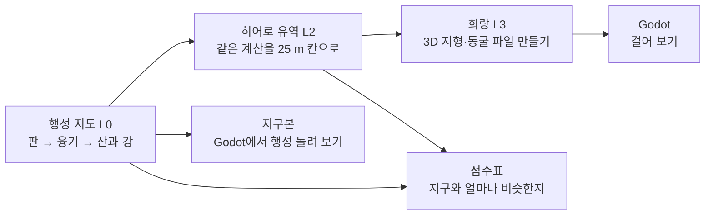

# B-PCG

B-PCG is a procedural generator for an Earth-sized planet, written in C# (.NET 10). It solves plate-driven uplift, rainfall and river incision as a steady state on a cube-sphere. It then derives the subsurface (strata, groundwater, caves) from the same rock and water. One river basin is baked into a walkable 3D corridor for Godot 4.7.2 .NET, which can also generate planets itself. A scorecard compares the result with published Earth values and ETOPO; running the same metrics on real Earth data (ETOPO, RiverATLAS, OCTOPUS) is planned. This is a capstone project at Chung-Ang University (Fall 2026). Documentation is in Korean.

> 게임 속 지형은 보통 노이즈(무작위 값을 매끈하게 겹쳐 만든 높이 무늬)로 만듭니다. 보기에는 그럴듯하지만, 강이 바다까지 이어지지 않고 절벽이 왜 거기 있는지 설명할 수 없습니다. B-PCG는 지각판의 움직임부터 계산해 지구 크기의 행성을 만듭니다. 판이 부딪힌 곳에서 땅이 솟고, 그 땅에 내린 비가 강이 되어 산을 깎습니다. 그 산을 이룬 암석과 물이 그대로 땅속의 지층, 지하수, 동굴이 됩니다. 결과는 점수표(만든 행성이 물리 규칙을 지켰는지, 지구와 얼마나 비슷한지를 항목마다 숫자로 재는 표)로 잽니다. 지금은 지구 값을 논문과 ETOPO(지구 전체 높이 지도)에서 가져와 비교합니다. 같은 점수표를 진짜 지구 자료에 돌려 비교하는 코드는 아직 없습니다.

처음 합류했다면 이 파일 → [용어집](docs/glossary.md) → [한 장 요약](docs/brief.md) 순서로 읽습니다. 문서나 화면 글을 쓰기 전에는 [Humanize.md](Humanize.md)를 읽습니다.

---

## 직접 돌려 보기

### 1. 설치

맥·리눅스:

```bash
./scripts/setup.sh
```

윈도우(PowerShell):

```powershell
powershell -ExecutionPolicy Bypass -File scripts\setup.ps1
```

스크립트가 하는 일은 세 가지입니다.

- uv(파이썬 버전과 패키지를 한 번에 맞춰 설치하는 도구)가 없으면 먼저 설치하고, uv로 파이썬 3.13과 패키지를 설치합니다. 파이썬은 스튜디오(매개변수를 바꿔 행성을 다시 만들고, 결과를 지도로 보는 브라우저 도구), 시험, 분석에 씁니다.
- **.NET 10 SDK**가 있는지 확인합니다. 생성기와 엔진이 C#이라 꼭 있어야 합니다. 스크립트는 SDK를 설치하지 않고, 없으면 설치 명령을 알려 줍니다(맥 `brew install --cask dotnet-sdk`, 윈도우 `winget install --id Microsoft.DotNet.SDK.10 -e`).
- 끝나면 환경을 점검합니다(2단계와 같음).

필요할 때만 붙이는 옵션입니다(윈도우는 `-Godot`처럼 씁니다).

| 옵션 | 하는 일 |
|---|---|
| `--godot` | Godot(3D 세계를 보여 주는 오픈소스 게임 엔진) 4.7.2의 .NET 버전을 `.tools/godot-net/`에 받습니다. 엔진을 맡은 사람은 꼭 받습니다 |
| `--data` | 진짜 지구 자료 약 4.5 GB를 받습니다. 생성기 규칙의 숫자를 지구 자료로 맞추거나 비교하는 사람만 필요합니다. 끊겨도 다시 실행하면 이어 받습니다 |
| `--analysis` | 비교·분석 도구 두 개를 더합니다. pyflwdir는 높이 지도에서 물길 방향과 물이 모이는 양을 계산하고, landlab은 땅 겉의 변화를 계산하는 도구 모음입니다(둘 다 MIT 라이선스) |
| `--gpl` | 비교용 프로그램 두 개를 더합니다. fastscapelib은 땅이 솟고 강이 깎는 과정을 시간 순서로 계산하고, TopoToolbox는 높이 지도에서 물길과 강 가파름을 계산합니다. 둘 다 GPL 라이선스라 생성기 코드에서는 부르지 않고 `analysis/`에서만 씁니다. Linux ARM64에서는 설치할 수 없습니다 |
| `--notebook` | JupyterLab을 더합니다 |
| `--check` | 설치하지 않고 점검만 합니다 |

### 2. 환경 점검

```bash
uv run python tools/doctor.py
```

- 맞게 깔렸으면 마지막 줄이 `필수 실패 0개, 주의 N개 (…초)`처럼 나옵니다.
- `[주의] Godot .NET … 없음`은 엔진을 맡지 않았다면 그대로 두어도 됩니다.
- 걸리는 시간: 약 10초(맥북 에어 M3).

### 3. 작은 행성 하나 만들기

```bash
uv run bpcg all --profile tiny
```

tiny 프로필(몇 초 만에 끝나도록 크기와 해상도를 줄인 설정)로 행성 하나를 처음부터 끝까지 만듭니다. 순서는 행성 → 강 유역 하나 → 걸어 다닐 띠 → 지구본입니다.

- 맞게 돌았으면 마지막 줄이 `[전체] 끝: 1.5 s → …/out/earth`처럼 나옵니다. `out/earth/` 아래에 `planet`, `hero`, `corridor`, `globe` 폴더가 생깁니다.
- 걸리는 시간: 명령 전체 약 3초(맥북 에어 M3). 처음에는 C# 빌드가 먼저 돌아 더 걸립니다.
- 노트북 기본 크기인 laptop 프로필(`uv run bpcg all --profile laptop`)은 약 70~90초 걸리고, 메모리를 최대 약 3.4 GB 씁니다(`/usr/bin/time -l`의 peak memory footprint). 맥북 에어 M3(메모리 16 GB)에서 다른 프로그램이 함께 돌던 상태로 두 번 잰 값입니다.

### 4. 결과 보기

```bash
uv run bpcg studio
```

- 브라우저에 스튜디오가 열립니다(http://127.0.0.1:8765). 왼쪽에서 매개변수를 바꿔 행성을 다시 만들고, 오른쪽에서 지도를 봅니다.
- 쓰는 법은 [docs/studio.md](docs/studio.md)에 있습니다.

### 5. 자주 쓰는 명령

```bash
uv run bpcg compare run           # 기존 지형 생성 방법과 같은 시드로 비교 (docs/compare.md)
dotnet build Bpcg.slnx            # C# 빌드 (생성기, 명령줄, 엔진, 시험)
dotnet test --solution Bpcg.slnx  # C# 시험 (golden 파일과 비트까지 같은지 등)
uv run pytest -m "not slow"       # 파이썬 시험 (C# 결과 파일, 스튜디오)
uv run ruff format . && uv run ruff check .
.tools/godot-net/Godot_mono.app/Contents/MacOS/Godot --path engine -e   # 엔진 편집기 (맥)
```

- 시드는 같은 행성을 다시 만들 때 쓰는 출발 번호입니다. 시드가 같으면 어느 컴퓨터에서든 같은 행성이 나옵니다.
- `compare run`은 지형 생성 리뷰 논문(Galin 외 2019)이 꼽은 기존 방법 10개와 B-PCG를 같은 시드로 돌려, 같은 지표로 비교합니다.
- golden 파일은 옛 Python 생성기의 결과를 정답으로 저장해 두고, 새 결과가 비트까지 같은지 비교하는 시험 자료입니다(`tests/golden/`).

---

## 무엇을 만드나

같은 땅을 세 가지 배율로 만듭니다. 앞 배율의 결과가 다음 배율의 출발점입니다.

- 행성 지도(L0)는 행성 전체를 바둑판 칸으로 나눈 지도입니다.
- 히어로 유역(L2)은 행성에서 고른 유역(빗물이 모여 한 출구로 흘러 나가는 땅) 하나를 25 m 칸으로 다시 계산한 땅입니다.
- 회랑(L3)은 히어로 유역 안에서 플레이어가 걸어 다니도록 3D 지형 파일로 만든 띠입니다.

| 배율 | 이름 | 크기 | 하는 일 |
|---|---|---|---|
| 거시 | 행성 지도 (L0) | 지구 전체. 칸 한 변 약 19.5 km(서울 남북 길이의 3분의 2), 칸 157만 개 | 판, 지각, 융기(땅이 솟아오르는 움직임), 기후를 정하고 큰 강과 산맥을 계산합니다 |
| 중간 | 히어로 유역 (L2) | 한 변 32 km(서울만 한 네모), 칸 25 m | 같은 계산을 촘촘한 칸으로 다시 해서 골짜기, 지층, 지하수, 동굴의 높이를 정합니다 |
| 미시 | 회랑 (L3) | 6 km × 1 km 띠(여의도의 약 2배), 2 m 간격 | 걸어 다닐 수 있는 3D 지형과 땅속을 미리 계산해 Godot가 읽는 파일로 만듭니다. 이 일을 '굽기'라고 부릅니다 |



말이 낯설면 [용어집](docs/glossary.md)을 봅니다. 계산의 자세한 순서와 공식은 [docs/pipeline.md](docs/pipeline.md)에 있습니다.

---

## 지원 환경

| 운영체제 | 지원 | 비고 |
|---|---|---|
| macOS 15 이상, Apple Silicon | 됨 | 개발 맥에서 시험함 |
| Windows 10/11 x64 | 됨 | CI(GitHub가 PR마다 자동으로 돌리는 빌드·시험)에서 돌림. 팀원 컴퓨터에서 첫 시험이 필요함 |
| Linux x86_64(glibc 2.28 이상) | 됨 | CI에서 돌림 |
| Windows ARM64 | x64 파이썬을 에뮬레이션으로 씀 | 시험하지 않음 |
| Linux ARM64 | 기본 패키지만 | 분석용 GPL 도구(fastscapelib, TopoToolbox)는 설치할 수 없음 |
| Intel Mac, macOS 14 이하 | 안 됨 | 분석에 쓰는 파이썬 패키지 numba와 rasterio의 설치 파일이 없음 |

파이썬은 3.13으로 고정합니다. 이유는 [docs/conventions.md](docs/conventions.md) 11절에 있습니다.

## 폴더

| 폴더 | 들어 있는 내용 |
|---|---|
| `src/Bpcg/` | 생성기 본체(C#). 단계마다 폴더가 하나씩 있습니다: `Core/`(칸과 설정), `Planet/`(판·융기), `Hydro/`(물길), `Landscape/`(솔버. 산과 강이 다 자란 모양을 반복 계산으로 한 번에 구하는 프로그램) … `Runs.cs`가 실행 순서를 정합니다 |
| `src/Bpcg.Cli/` | 명령줄 `bpcg planet·hero·bake·all·compare·figures` (C#) |
| `src/Bpcg.Figures/` | 결과 그림(C#): 행성 지도, 지구본, 고도 분포, 히어로 지도, 단면, 3D 조감 PNG |
| `src/bpcg_studio/` | 스튜디오(파이썬)와 `bpcg` 명령의 입구. `studio` 밖의 명령은 C# 명령줄로 넘깁니다 |
| `engine/` | Godot 4.7.2 .NET 프로젝트(C#). 처음 화면에서 행성을 만들고, 회랑을 걷고, 지구본을 돌립니다. [engine/README.md](engine/README.md) |
| `tests/` | 파이썬 시험, `tests/Bpcg.Tests/`(C# 시험), `tests/golden/`(golden 파일) |
| `configs/` | 행성 값(`planets/`), 크기·해상도 설정(`profiles/`), 지구 자료로 맞춘 값(`learned/`), 방법 비교 설정(`compare/`). C#과 스튜디오가 같은 파일을 읽습니다 |
| `docs/` | 규칙, 설계도, 공식, 안내서, 지난 사정 기록 |
| `analysis/` | 한 번 돌리는 연구 스크립트(파이썬) |
| `tools/`, `scripts/` | 자료 받기·환경 점검, 설치 스크립트 |
| `data/`, `out/` | 받은 자료와 생성 결과. git에 올리지 않습니다. [data/README.md](data/README.md) |

맨 위의 `Bpcg.slnx`(C# 프로젝트 목록), `Directory.Build.props`(C# 공통 설정), `global.json`(.NET SDK 버전)은 C# 프로젝트 다섯(생성기, 명령줄, 결과 그림, 엔진, 시험)이 같이 씁니다. `CLAUDE.md`(Claude와 팀원이 따르는 작업·글쓰기 규칙)와 `Humanize.md`(말투 규칙)도 맨 위에 있습니다.

## 문서

처음 합류했다면 위에서부터 읽습니다.

| 문서 | 알 수 있는 내용 |
|---|---|
| [용어집](docs/glossary.md) | 히어로, 회랑, 정상상태 같은 말의 뜻 |
| [한 장 요약](docs/brief.md) | 프로젝트 전체를 한 번에 |
| [스튜디오](docs/studio.md) | 매개변수를 바꿔 돌리고 지도·Godot로 보기 |
| [함께 일하는 방법](CONTRIBUTING.md) | 브랜치, PR, 리뷰 |
| [개발 규칙](docs/conventions.md) | 폴더, 코드 규칙, git |
| [말투 규칙](Humanize.md) | 문서와 답변에서 고칠 말버릇과 고친 모양 |
| [글쓰기 안내서](docs/writing.md) | 문서와 화면 글의 틀, 크기 비유 표 |
| [생성 계산 명세](docs/pipeline.md) | 단계마다 공식과 함수의 약속 |
| [설계도](docs/design/blueprint.md) | 무엇을 왜 이렇게 만들기로 했나 (설계의 원본) |
| [개발 단계](docs/roadmap.md) | 할 일과 마감 |
| [방법 비교](docs/compare.md) | 기존 지형 생성 방법과 같은 시드로 견주기 |
| [엔진](engine/README.md) | Godot 조작키와 파일 형식 |
| [분석 스크립트](analysis/README.md) | 진짜 지구 자료로 하는 분석 |
| [프로젝트 기록](docs/history.md) | 지운 코드, 다시 올린 PR, 결정을 기다리는 일 같은 지난 사정 |
| [C# 포팅 기록](docs/csharp_port.md) | Python 생성기를 C#으로 옮긴 과정과 대조 결과 |
| [초기 설계 가이드](docs/guide/planet_guide.md) | 맨 처음 설계안 (설계도와 다르면 설계도를 따름) |

## 라이선스

코드 라이선스는 아직 정하지 않았습니다. 자료의 출처와 꼭 붙여야 하는 문구는 [data/README.md](data/README.md)에 있습니다.
