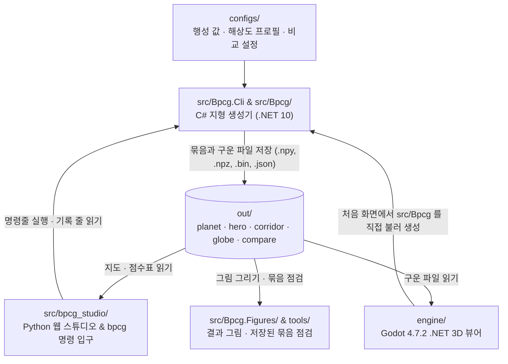

# 코드베이스 구조와 작동 원리 안내서

> 이 문서는 B-PCG 저장소가 무엇을 만드는 프로젝트이고, 코드가 어떤 순서와 원리로 돌아가는지 처음부터 끝까지 설명합니다. 판 운동·기후·암석에서 출발해 행성 전체(약 19.5 km 간격)부터 걸어 다니는 땅(2 m 간격)까지 세 가지 배율로 지형과 땅속 구조를 이어서 계산합니다. 이 문서의 칸 크기와 칸 수는 노트북 기본 설정(laptop 프로필)의 값이고, 다른 설정에서는 달라집니다. 같은 설정과 출발 번호(시드)로 만든 결과가 바이트까지 같다는 보장은 같은 운영체제와 CPU 종류 안에서만 맞습니다.

---

## 직접 돌려 보기

저장소 루트에서 아래 명령을 차례로 복사해 실행하면, 가장 작은 설정으로 행성부터 3D 뷰어용 파일까지 만들고 비교 도구까지 확인할 수 있습니다. `uv run bpcg`는 uv(파이썬 버전과 패키지를 한 번에 맞춰 설치하는 도구)로 띄우는 입구입니다. C# 명령줄(`src/Bpcg.Cli`)을 바뀐 파일만 빌드한 뒤 부릅니다(`src/bpcg_studio/cli.py`).

```bash
# 1. 가장 작은 프로필(tiny)로 행성 → 히어로 유역 → 회랑 → 지구본 한 번에 만들기
uv run bpcg all --profile tiny --out out/tiny

# 2. 만든 결과로 그림 9장과 요약 파일 뽑기
uv run bpcg figures results out/tiny

# 3. 기본 비교 설정의 12개(방법 11개와 매개변수만 바꾼 변형 1개)를 64 × 64 격자에서 돌리고 표로 비교하기
uv run bpcg compare run --param grid.n=64 --seeds 0 --out out/compare/try
uv run bpcg compare list --set try
```

- 맞게 돌았으면:
  - 1번 명령의 마지막 줄이 `[전체] 끝: 1.1 s → out/tiny`처럼 나옵니다. `out/tiny/` 아래에 `planet/`, `hero/`, `corridor/`, `globe/` 네 폴더가 생깁니다. 점수표는 `planet/scorecard.json`과 `hero/scorecard.json`에 있습니다.
  - 2번 명령의 마지막 줄이 `그림을 썼습니다: out/tiny/figures`입니다. 그 폴더에 `planet_layers.png`, `hero_map.png`, `cross_section.png` 등 그림 9장과 `summary.json`이 생깁니다.
  - 3번의 `compare run`은 마지막 줄이 `[비교] 끝: 0.5 s → out/compare/try`처럼 나옵니다. `compare list`는 `== 시드 0` 아래에 머리글 한 줄과 12줄을 찍습니다. 줄마다 생성 시간과 지표 12개(기복, 웅덩이 넓이, 하천 밀도 등)가 있습니다.
- 걸리는 시간: 1번 약 2초, 2번 약 7초, 3번의 `compare run` 약 2초. 맥북 에어 M3(8코어, 메모리 16 GB)에서 C# 빌드가 끝난 상태로 2026-11-12에 각각 서너 번 잰 값입니다. 다른 프로그램이 함께 돌고 있었습니다. 처음 돌릴 때는 C# 빌드 시간이 더 듭니다.

---

## 1. 이 프로젝트가 하는 일과 핵심 아이디어

### 1.1 왜 노이즈 대신 물리 법칙으로 지형을 푸는가

기존 절차적 지형 생성기는 대부분 무작위 무늬(노이즈)를 여러 겹 포개 산처럼 보이는 울퉁불퉁한 면을 만듭니다. 그 방법은 빠르지만 두 가지 한계가 있습니다.

1. **물길이 이어지지 않습니다.** 노이즈로 만든 땅에 빗물을 흘려보내면 사방이 막힌 웅덩이(사방이 더 높은 땅에 막혀 물이 고이는 자리)에 물이 갇혀 바다까지 내려가지 못합니다.
2. **땅 위와 땅속이 따로 놉니다.** 산 모양을 먼저 그리고 강·호수·동굴·지층을 나중에 덧칠하기 때문에, 왜 거기에 절벽이 서고 왜 그 높이에 동굴이 뚫렸는지 앞뒤가 맞지 않습니다.

B-PCG는 무작위 무늬를 쌓는 대신 **땅이 솟아오르는 힘, 비가 내려 흐르는 물길, 암석의 단단함**이라는 세 가지 물리 조건에서 출발합니다.

### 1.2 수천만 년을 기다리지 않고 '다 자란 모양'만 바로 구하기

실제 산맥은 수백만 년에서 수천만 년에 걸쳐 자랍니다. 이를 1년 단위로 쪼개 시간 순서대로 계산하면, 행성 하나를 만드는 데 몇 시간이 걸립니다.

그런데 오래 자란 산은 어느 순간부터 높이가 거의 바뀌지 않습니다. 땅이 밑에서 솟아오르는 속도와 강물이 위에서 깎아 내리는 속도가 같아지기 때문입니다. 이 프로젝트는 시간 순서로 땅을 깎는 대신, 처음부터 솟는 속도와 깎이는 속도가 비기는 정상상태(땅이 솟는 속도와 강이 깎는 속도가 같아져 높이가 더 바뀌지 않는 상태) 방정식을 직접 풉니다. 바다 해안선(`0 m`)에서 출발해 상류로 한 칸씩 거슬러 올라가며, 그 칸에 모인 물의 양과 암석 종류에 맞는 경사를 차곡차곡 더해 높이를 구합니다.

### 1.3 행성 전체에서 발밑까지 이어지는 3단계 해상도 사다리

지구만 한 행성 전체를 사람 키 수준(2 m)의 촘촘한 격자로 한 번에 나누면 칸 수가 약 128조 개(1.28 × 10^14)입니다. 지구 겉넓이 약 5.1억 km²를 칸 넓이 4 m²로 나눈 값입니다. 칸마다 높이 하나(4바이트)만 담아도 약 510 TB라 일반 컴퓨터 메모리에 들어가지 않습니다. 그래서 B-PCG는 해상도를 세 가지 배율로 나누어 필요한 곳만 확대합니다. 이 세 배율은 3장의 계산 순서(1~4단계)와 다른 말입니다.

| 배율 | 코드 표기 | 다루는 범위 | 칸 간격 (`laptop` 기준) | 칸 개수 | 일상 크기 비유 |
|---|---|---|---|---|---|
| 거시: 행성 전체 지도 | `L0` | 반지름 6,371 km 구면 전체 | 약 19.5 km | $6 \times 512^2 = 1,572,864$칸 | 칸 하나가 서울 남북 길이(30 km)의 3분의 2 |
| 중간: 정밀 유역 지도 | `L2` | 히어로 유역(행성에서 골라 25 m 간격으로 다시 푼 강 유역 하나) $32\text{ km} \times 32\text{ km}$ | 25 m | $1280 \times 1280 = 1,638,400$칸 | 전체는 서울만 한 네모, 칸 하나는 25 m 수영장 레인 길이 |
| 미시: 3D 보행 세계 | `L3` | 회랑(히어로 유역 안에서 골라 사람이 걸어 다니는 6 km × 1 km 땅) | 높이맵 2 m / 재질 부피는 수평 4 m, 수직 2 m | $3001 \times 501$ 표본 (높이맵) | 전체 넓이는 여의도의 약 2배, 칸 하나는 사람 키 정도 |

행성 지도(`L0`)에서 구한 융기 속도(땅이 솟는 속도), 비와 유출, 지층이 쌓인 순서와 깎인 두께, 출구 높이를 히어로 유역(`L2`)이 물려받아 같은 규칙으로 다시 풉니다. 회랑(`L3`)은 히어로 유역의 결과를 2 m 간격으로 읽어 파일로 굽습니다. 그래서 우주에서 본 산맥과 걸어 다니며 보는 절벽·동굴이 같은 융기와 암석에서 나옵니다.

---

## 2. 코드베이스 전체 구조와 역할 분담

이 저장소는 크게 **C# 지형 생성기**, **Godot 3D 뷰어**, **Python 웹 스튜디오 및 분석 스크립트** 세 부분으로 나뉩니다. 스튜디오와 생성기는 디스크에 저장된 묶음(한 단계가 만든 지도 파일과 목차를 한 폴더에 모은 결과물) 폴더로만 값을 주고받습니다. 엔진은 구운 파일을 읽어 보여 주고, 처음 화면에서는 생성기 라이브러리(`src/Bpcg`)를 직접 불러 행성을 만듭니다.



### 2.1 폴더별 핵심 파일과 역할

| 폴더 / 프로젝트 | 언어 | 하는 일 | 핵심 파일 |
|---|---|---|---|
| `src/Bpcg/` (`Bpcg.csproj`) | C# (.NET 10) | 행성·히어로 유역·회랑·지구본을 계산하고 파일로 굽는 핵심 라이브러리 | `Pipeline.cs`, `Runs.cs`, `Core/Config.cs` |
| `src/Bpcg.Cli/` (`Bpcg.Cli.csproj`) | C# (.NET 10) | `planet`, `hero`, `bake`, `all`, `compare`, `figures` 명령을 실행하는 콘솔 입구. 지구본은 `bake`와 `all`이 함께 굽습니다 | `Program.cs`, `CompareCommand.cs`, `FiguresCommand.cs` |
| `src/Bpcg.Figures/` (`Bpcg.Figures.csproj`) | C# (.NET 10) | `bpcg figures`가 그리는 결과 그림(행성 지도, 고도 분포, 히어로 지도, 단면, 3D 조감) | `ResultFigures.cs`, `PlanetFigures.cs`, `HeroFigures.cs` |
| `engine/` (`Bpcg.Engine.csproj`) | C# (Godot 4.7.2 .NET) | 처음 화면에서 행성을 만들고, 구운 회랑과 지구본을 3D로 보여 주는 뷰어. 걸어 다니며 단면을 자를 수 있습니다 | `Scripts/StartMenu.cs`, `Scripts/Main.cs`, `Scripts/BakedLayers.cs`, `Scripts/StrataVolume.cs`, `Scripts/GlobeMain.cs` |
| `src/bpcg_studio/` | Python 3.13 | 웹 브라우저에서 설정을 바꾸고 지도를 뜯어보는 로컬 스튜디오(`127.0.0.1:8765`)와 `bpcg` 명령의 입구 | `cli.py`, `server.py`, `jobs.py`, `params.py`, `views.py` |
| `configs/` | TOML | 행성 값(`planets/earth.toml`, 화성 크기 행성 `planets/mars.toml`), 해상도 프로필(`profiles/`의 `tiny`·`laptop`·`lab`), 비교 설정(`compare/default.toml`), 지구 자료로 맞춘 값을 둘 자리(`learned/`, 지금은 비어 있음). `mars.toml`은 반지름, 밀도, 자전 주기, 바다 물의 부피, 지각 세기 한계 높이만 `earth.toml`과 다릅니다 | `earth.toml`, `laptop.toml`, `tiny.toml` |
| `tests/` | C# & Python | C# 단위·정답 대조 시험(`tests/Bpcg.Tests/`)과 Python 통합·스튜디오·엔진 시험(`tests/test_*.py`) | `Golden.cs`, `test_pipeline.py`, `test_engine.py` |
| `analysis/` & `data/` | Python | `analysis/`는 설계도의 숫자를 뒷받침하려고 한 번씩 돌린 연구 스크립트입니다(가봉 숲 레이더 자료 AfriSAR 분석, 행성 크기 계산 등). 생성기와 스튜디오는 이 폴더를 부르지 않습니다. `data/`는 받은 지구 자료를 두는 곳이고 git에 올리지 않습니다(`data/pilot/`, AfriSAR는 `data/external/afrisar/`) | `analysis/scale/scale_ladder_calcs.py`, `analysis/afrisar/`, `analysis/dem_catalog/` |
| `tools/` | Python | 개발 환경 점검(`doctor.py`), 파일럿 데이터 내려받기(`download_pilot.py`), 저장된 행성·히어로 묶음을 읽어 지표와 지도를 뽑는 점검(`plausibility_audit.py`) | `doctor.py`, `download_pilot.py` |

### 2.2 `src/Bpcg/` 내부 모듈 지도

C# 생성기 라이브러리(`src/Bpcg/`)는 계산 단계에 따라 13개 하위 폴더로 나뉩니다. 아래 목록은 함께 쓰는 폴더를 묶어 아홉 줄로 적었습니다.

1. **`Core/`**: 큐브스피어(주사위 여섯 면을 부풀려 공 모양으로 만든 격자)와 평면 격자(`Cubesphere.cs`, `Graph.cs`), 구면 보간(`Resample.cs`), 가장 가까운 출발 칸까지의 거리(`Distance.cs`), 시드(같은 행성을 다시 만들 때 쓰는 출발 번호)와 칸 번호로 무작위 값을 만드는 정수 해시(`Hashing.cs`)와 노이즈(`Noise.cs`), 설정 읽기(`Config.cs`), 병렬 반복(`Parallelism.cs`).
2. **`IO/` & `Numerics/`**: 배열을 `.npy`/`.npz`로 읽고 쓰는 `IO/Npy.cs`·`IO/Npz.cs`, TOML과 JSON을 읽고 쓰는 `IO/Toml.cs`·`IO/PyJson.cs`. `Numerics/`는 numpy·scipy(파이썬 수치 계산 라이브러리)와 같은 값을 내도록 연산 순서를 맞춘 함수입니다: 스칼라 연산(`NpMath.cs`), 짝지어 더하기(`NpReduce.cs`), 3차원 벡터 연산(`LinAlg.cs`), 가까운 점을 찾는 `KdTree.cs`.
3. **`Planet/`**: 판(`Plates.cs`), 지각 두께와 기준 고도(`Crust.cs`), 해수면과 바다 칸(`Ocean.cs`), 융기 속도(`Uplift.cs`), 위도와 높이로 정하는 비·기온·유출(`Climate.cs`)을 만드는 1단계 모듈. `Materials.cs`가 이 값들을 거친 격자에서 만들어 L0로 옮깁니다.
4. **`Geology/`**: 암석 12종의 물성표와 변성 규칙(`Rocks.cs`), 지층이 쌓인 순서 세 가지와 습곡, 칸마다 땅속 지층 기둥(`Model.cs`).
5. **`Hydro/`**: 웅덩이를 메우는 `Depressions.cs`, 물이 흘러갈 이웃을 고르는 `Routing.cs`, 상류부터 물과 퇴적물을 합산하는 `Accumulate.cs`, 유역과 강 구간을 묶는 `Network.cs`.
6. **`Landscape/`**: 지형 높이를 구하는 솔버(지형 높이를 구하는 계산기)인 `Solver.cs`, 산골짜기 입구에 흙을 쌓는 `Fans.cs`, 큰 칸 안의 작은 기복을 추정하는 `Relief.cs`, 히어로 유역을 거친 격자에서 먼저 푸는 `Warmstart.cs`.
7. **`Subsurface/`**: 호수·강 수면과 강의 폭·깊이(`Water.cs`), 토양·충적층 두께(`Soil.cs`), 지하수면(땅속 빈틈이 물로 가득 차기 시작하는 높이)을 어림하는 `Groundwater.cs`, 동굴 층의 높이와 입구를 정하는 `Caves.cs`.
8. **`Hero/` & `Volume/`**: 히어로 유역을 둘 자리를 고르는 `Finder.cs`, 구면 조각을 평면 격자로 펴는 `Domain.cs`, L0 값을 받아 2~4단계를 다시 푸는 `Refine.cs`, 행성 없이 히어로 유역만 만드는 `Flat.cs`, 임의의 $(x, y, z)$ 점이 공기·물·어떤 암석인지 판정하는 3D 샘플 함수 `Volume/Sample.cs`(`HeroVolume`).
9. **`Bake/`, `Metrics/`, `Compare/`**: 묶음을 읽고 쓰는 `Bundle.cs`, Godot 엔진이 읽을 파일을 굽는 `Corridor.cs`와 `Globe.cs`, 행성 지도 16개와 히어로 유역 13개 항목을 채점하는 `Scorecard.cs`, 기존 지형 생성법 10가지와 B-PCG를 같은 격자에서 맞비교하는 `CompareRunner.cs`.

---

## 3. 세 갈래 인과 사슬과 4단계 생성 파이프라인

생성 파이프라인(`src/Bpcg/Pipeline.cs`)은 세 갈래 인과 사슬을 따라 행성 하나를 네 단계로 만듭니다. 1단계는 재료(판, 지각, 융기, 기후, 지질), 2단계는 솔버, 3단계는 후처리(산 앞에 쌓인 흙과 큰 칸 안의 높이 차를 덧붙임), 4단계는 땅속 값입니다. 실행 기록 줄의 `[1단계]`~`[4단계]`가 이 번호입니다. 히어로 유역은 같은 2~4단계를 25 m 칸으로 다시 돌리고, 회랑 굽기에는 단계 번호가 없습니다.


---

### 3.1 1단계: 행성 재료와 3D 지층 만들기 (`Planet/` & `Geology/`)

#### ① 큐브스피어 격자와 노드 흔들기 (`Core/Cubesphere.cs`, `Core/Graph.cs`)

공 모양 행성에 일반 위도·경도 격자를 씌우면 북극과 남극 근처에서 칸이 좁아지고 몰립니다. 그래서 주사위 여섯 면($+X, -X, +Y, -Y, +Z, -Z$)을 각각 $n \times n$ 칸으로 나눈 뒤 공 모양으로 부풀린 큐브스피어를 씁니다. 각도를 똑같이 나누는 탄젠트 투영($u = \tan(\frac{\pi}{4}\xi)$)을 씁니다. 그래서 한 면 안에서 가장 큰 칸의 넓이가 가장 작은 칸의 약 1.4배에 그칩니다(면당 512칸에서 1.41배).

바둑판처럼 줄 맞춰 선 칸에서 이웃 여덟 칸으로만 물을 흘리면 강이 가로·세로·$45^\circ$ 대각선으로만 곧게 뻗는 문제가 생깁니다. 이를 막기 위해 노드 흔들기(격자 줄무늬가 드러나지 않도록 칸 중심을 조금씩 옮기는 일)를 적용합니다. `landscape.jitter = 1.0`이면 각 칸 중심을 가로·세로 최대 반 칸($\pm 0.5$칸)까지 무작위로 흔듭니다. 흔든 뒤의 칸 사이 거리 $d_{cc'}$(공에서는 구면을 따라 잰 거리)를 `CellGraph.Dist`에 담아 모든 경사 식에 씁니다.

#### ② 판 운동과 거친 지각 평형 (`Planet/Plates.cs`, `Planet/Crust.cs`, `Planet/Ocean.cs`, `Planet/Uplift.cs`)

먼저 거친 구면 격자(`profile.grid.coarse_n_per_face`, `laptop` 기준 면당 $128 \times 128$칸, 칸 간격 약 78 km로 제주도 동서 길이보다 조금 김)에서 판을 나눕니다. 씨앗 점 12개(`plates.count`)를 구면에 뿌리고, 칸마다 가장 가까운 씨앗의 판에 넣습니다. 이때 칸 위치를 노이즈로 조금 비틀어 재서 판 경계가 구불구불해집니다. 대륙 지각이 놓일 자리는 판과 따로 정합니다. 노이즈 점수가 높은 칸부터 골라 겉넓이의 40%(`plates.continental_area_fraction`)를 채웁니다(`Crust.ContinentMask`). 판마다 회전축과 각속도를 주어 판 경계에서 두 판이 부딪치는지(수렴), 갈라지는지(발산), 스쳐 지나가는지(변환) 판정합니다.

이어서 대륙 지각과 해양 지각의 두께·밀도 차이로 기준 고도를 어림잡습니다. 지구 바다 물 부피($1.335 \times 10^{18}\text{ m}^3$, `ocean.water_volume_m3`)를 낮은 곳부터 채웠을 때의 수면 높이를 해수면으로 잡아 바다 칸과 육지 칸을 나눕니다.

그다음 칸마다 융기 속도 $U$(땅이 솟는 속도, $\text{m/yr}$)를 정합니다. 대륙 지각 칸과 육지 칸에 바탕 값 $0.005\text{ mm/yr}$(100만 년에 5 m, `uplift.craton_erosion_m_per_myr`)을 깔고, 산맥 띠에서는 그 위에 더합니다. 바다 판이 다른 판 아래로 파고드는 경계(섭입)에서는 위쪽 판의 산맥이 $0.03 \times$ (두 판이 마주 오는 속도)로 솟습니다(`uplift.orogen_factor`). 대륙끼리 부딪힌 경계(충돌)에서는 $0.04$배입니다(`uplift.collision_factor`). 예를 들어 마주 오는 속도가 5 cm/yr이면, 노이즈를 곱하기 전 값으로 섭입 산맥은 $1.5\text{ mm/yr}$(1,000년에 1.5 m), 충돌대는 $2\text{ mm/yr}$입니다. 섭입 산맥은 판 경계에서 약 200 km 떨어진 띠에서 가장 빠르게 솟고, 그 띠에서 80 km 벗어나면 약 37%로 줄어듭니다(`uplift.orogen_width_m`). 충돌대는 경계 위에서 가장 빠르고, 100 km 떨어지면 약 37%입니다(`uplift.collision_width_m`).

#### ③ 위도와 높이로 정하는 가벼운 기후 (`Planet/Climate.cs`)

바람과 비그늘(산이 비구름을 막아 한쪽에만 비가 많이 오는 효과)은 계산하지 않습니다. 비는 위도로 정합니다. 적도와 중위도(위도 50° 근처)에 비가 많고 그 사이가 건조한 띠를 만든 뒤, 곳마다 다른 노이즈를 곱합니다. 지구 설정에서 노이즈를 빼면 강수량 $P$는 적도 약 $2.05\text{ m/yr}$, 위도 25° 약 $0.29\text{ m/yr}$, 위도 50° 약 $1.15\text{ m/yr}$입니다.

기온 $T$는 위도와 높이로 정합니다. 적도 27 °C에서 극 −25 °C까지 낮아지고, 1 km 오를 때마다 6.5 °C 내려갑니다. 예를 들어 위도 45°, 높이 1,000 m인 칸은 −5.5 °C입니다.

물이 넉넉할 때 증발할 수 있는 양(잠재 증발산 $\text{PET}$)은 기온에 비례하게 둡니다($\text{PET} = 0.055 \times \max(T, 0) + 0.1\text{ m/yr}$). 실제로 증발하는 양은 버디코(Budyko) 곡선으로 어림하고, 강수량에서 그 양을 뺀 나머지가 강으로 흘러드는 유출 $R$($\text{m/yr}$)입니다. 예를 들어 $P = 1.0\text{ m/yr}$, $\text{PET} = 1.0\text{ m/yr}$이면 $R \approx 0.31\text{ m/yr}$입니다. 아주 건조한 곳에서도 강이 조금은 깎도록, 침식에 쓰는 유효 유출량 $R_{\text{eff}}$에는 바닥값을 둡니다: $R_{\text{eff}} = \max(R,\ 0.1 \times P,\ 0.01\text{ m/yr})$.

#### ④ 3D 지층 기둥과 12가지 암석 (`Geology/Rocks.cs`, `Geology/Model.cs`)

지형이 다 만들어진 뒤 표면에 줄무늬를 칠하는 대신, 지형을 깎기 전에 칸마다 땅속에 어떤 암석이 몇 m씩 쌓였는지(지질 기둥)를 먼저 세웁니다(`Model.GenerateGeology`). 암석 표에는 열두 가지가 있습니다. 각각 깎이기 쉬운 정도(K 배율, 클수록 잘 깎임), 비탈이 무너지지 않고 버티는 최대 기울기($S_{\text{crit}}$), 물이 스며드는 정도(투수율 $\log_{10} k$, $k$의 단위는 $\text{m}^2$), 물에 녹는지 여부(`Rocks.Soluble`)가 다릅니다. 물에 녹는 암석은 석회암과 대리암 둘입니다.

| 번호 | 암석 이름 | K 배율 (무차원) | 임계 경사 $S_{\text{crit}}$ (각도) | 투수율 $\log_{10} k$ | 물에 녹는가 | 나오는 자리 |
|---|---|---|---|---|---|---|
| 0 | 충적층 (alluvium) | $3.0$ | $0.4$ (약 $22^\circ$) | $-10.9$ | 아니요 | 강이 쌓은 모래·자갈. 3D 샘플 함수가 지표 바로 아래에 둠 |
| 1 | 사암 (sandstone) | $0.5$ | $0.75$ (약 $37^\circ$) | $-12.5$ | 아니요 | 퇴적층 |
| 2 | 셰일 (shale) | $2.0$ | $0.5$ (약 $27^\circ$) | $-16.5$ | 아니요 | 퇴적층. 물이 거의 통하지 않아 지하수를 막는 층 |
| 3 | 석회암 (limestone) | $0.6$ | $0.8$ (약 $39^\circ$) | $-11.8$ | **예** | 퇴적층. 동굴 층이 놓이는 암석 |
| 4 | 화강암 (granite) | $0.3$ | $0.8$ (약 $39^\circ$) | $-14.1$ | 아니요 | 모든 기둥의 맨 아래 기반암 |
| 5 | 화산암 (volcanic) | $0.5$ | $0.75$ (약 $37^\circ$) | $-12.5$ | 아니요 | '기반암 + 화산호' 기둥의 맨 위 800 m |
| 6 | 점판암 (slate) | $0.8$ | $0.7$ (약 $35^\circ$) | $-14.1$ | 아니요 | 셰일이 250 °C 이상에서 바뀐 암석 |
| 7 | 편암 (schist) | $0.6$ | $0.7$ (약 $35^\circ$) | $-14.1$ | 아니요 | 셰일이 400 °C 이상에서 바뀐 암석 |
| 8 | 편마암 (gneiss) | $0.35$ | $0.8$ (약 $39^\circ$) | $-14.1$ | 아니요 | 셰일이 600 °C, 화강암이 650 °C 이상에서 바뀐 암석 |
| 9 | 대리암 (marble) | $0.5$ | $0.8$ (약 $39^\circ$) | $-11.8$ | **예** | 석회암이 350 °C 이상에서 바뀐 암석 |
| 10 | 규암 (quartzite) | $0.25$ | $0.85$ (약 $40^\circ$) | $-14.1$ | 아니요 | 사암이 350 °C 이상에서 바뀐 암석 |
| 11 | 흙 (soil) | $4.0$ | $0.6$ (약 $31^\circ$) | $-11.0$ | 아니요 | 암석 위를 덮은 흙. 3D 샘플 함수가 지표 바로 아래에 둠 |

K 배율은 뒤의 강 경사 식에 들어갑니다. 예를 들어 같은 융기와 유량에서 화강암(0.3) 강은 셰일(2.0) 강보다 $\sqrt{2.0 / 0.3} \approx 2.6$배 가파릅니다.

지층이 쌓인 순서(지질 템플릿)는 세 가지로 정해 둡니다(`Model.Templates`). 석회암이 두꺼운 평평한 퇴적층(탄산염 탁상지), 지층이 휘고 겹쳐 밀려 올라간 산지(습곡충상대), 화산암 800 m 아래가 바로 화강암인 기둥(기반암 + 화산호)입니다. 칸마다 판 경계까지의 거리로 셋 가운데 하나를 고릅니다(`Model.AssignTemplate`). 습곡충상대에서는 지층을 물결처럼 오르내리게 합니다(습곡). 물결의 길이는 15 km(`geology.fold_wavelength_m`)이고, 높이는 융기가 가장 빠른 칸에서 1,500 m(`geology.fold_amplitude_m`)입니다. 지층이 끊어져 어긋나는 단층은 만들지 않습니다. 이렇게 정한 층 바닥 높이 $z_{\text{bottom}}(c, l)$이 필드 `strata_bottom_m`이고, 층마다의 암석 번호가 `strata_rock`입니다(`Model.BuildColumns`).

---

### 3.2 2단계: 정상상태 지형과 물길 풀기 (`Hydro/` & `Landscape/`)

2단계는 이 프로젝트의 심장부인 `Solver.SolveSteadyState`(`src/Bpcg/Landscape/Solver.cs`)가 맡습니다. 물길은 땅 높이를 따라 흐르고, 땅 높이는 물길을 따라 쌓이므로 두 값을 한 번에 알 수 없습니다. 그래서 물길 방향이 더 이상 바뀌지 않을 때까지 다섯 걸음(①~⑤)을 되풀이합니다.

```text
2단계: 산과 강의 모양 풀기 (SolveSteadyState)
  ① 물이 갇히는 웅덩이를 메워 모든 칸이 바다(또는 출구)로 이어지게 함 (Priority-Flood)
  ② 칸마다 여덟 이웃 가운데 가장 가파른 내리막 이웃 하나를 수신 칸으로 고름 (D8 + 히스테리시스)
  ③ 상류에서 하류로 내려가며 물의 양(Q)과 흙의 양(Qs)을 더함
  ④ 물의 양·흙의 양·암석 종류로 각 칸이 가져야 할 평형 경사 S를 계산함
  ⑤ 출구(행성에서는 바다 0 m)에서 상류로 거슬러 올라가며 지층 경계마다 경사를 쌓아 새 높이 z를 구함
  → 물길 방향이 바뀐 칸이 0개이고 모든 칸의 높이 변화가 0.1 m 미만이면 멈춤, 아니면 ①로 돌아감
```

반복 상한은 행성 지도 200번(`landscape.max_flow_iterations`), `laptop` 히어로 유역 800번(`profile.hero.max_flow_iterations`)입니다.

#### ① 웅덩이 메우기 (`Hydro/Depressions.cs`)

현재 높이 $z$에 빗물을 흘렸을 때 사방이 막혀 물이 고이는 웅덩이가 있으면 상류에서 하류까지 물길이 끊깁니다. 바다(출구) 칸들을 우선순위 큐(힙)에 넣고 낮은 칸부터 안쪽으로 넓혀 가며 웅덩이를 메웁니다. 이때 출구 쪽에서 한 칸 들어갈 때마다 높이를 1 mm($\varepsilon = 10^{-3}\text{ m}$, `landscape.fill_epsilon_m`) 이상 높게 둡니다(`Depressions.FillEpsilon`). 그래서 모든 육지 칸에 더 낮은 이웃이 생겨 바다까지 막힘없이 이어집니다. 예를 들어 둑 높이가 100 m인 웅덩이는 둑 바로 안쪽 칸이 100.001 m, 그다음 칸이 100.002 m가 됩니다. 메운 높이는 물길 방향을 정할 때만 쓰고, 땅 높이는 ⑤에서 다시 쌓습니다.

#### ② 물길 방향 고르기와 진동 방지 장치 (`Hydro/Routing.cs`)

각 칸 $c$는 이웃 칸들 가운데 경사 $(z_c - z_n) / d_{cn}$이 가장 가파른 이웃 하나를 수신 칸(물이 흘러 들어가는 이웃 칸) $r(c)$로 고릅니다(D8 라우팅).

이때 두 이웃의 경사가 비슷하면 반복할 때마다 물길이 왼쪽·오른쪽으로 왔다 갔다 뒤집혀 반복 상한까지 멈추지 못할 수 있습니다. 이를 막기 위해 두 가지 장치를 씁니다.
- **히스테리시스(`landscape.hysteresis_eta = 0.02`)**: 새 이웃의 경사가 직전 반복에서 쓰던 이웃의 경사보다 $2\%$ 초과해 가파를 때만 물길 방향을 바꿉니다. 예를 들어 지금 이웃의 경사가 0.100이면 새 이웃은 0.102를 넘어야 합니다.
- **방향 고정(`Solver.FreezeAfterFlips = 16`)**: 방향이 16번 바뀐 칸은 그 뒤로 옛 방향을 지킵니다. 옛 방향의 이웃이 더 낮지 않아 물이 거꾸로 흐르게 될 때만 바꿉니다. 이런 칸을 고정 칸이라고 부르고, 실행 기록 줄에는 '방향을 묶은 칸'으로 나옵니다. 설정에 `landscape.freeze_after_flips`를 적으면 16 대신 그 값을 씁니다.

#### ③ 상류 유량과 퇴적물 누적 (`Hydro/Accumulate.cs`)

모든 칸이 수신 칸 하나씩만 가리키므로, 물길은 순환이 없는 트리(방향 비순환 그래프)를 이룹니다. 바다에서 가까운 하류부터 상류 순으로 정렬한 배열(`order`)을 거꾸로 읽으면, 상류 산꼭대기부터 하류 바다까지 한 번에 값을 누적할 수 있습니다. 각 칸의 집수 넓이(한 칸으로 빗물을 모아 주는 상류 땅의 넓이) $A_c$, 유량(상류에서 모여 한 칸을 지나가는 물의 양) $Q_c$, 퇴적물 유량 $Q_{s,c}$를 아래처럼 더합니다.

$$Q_c = A_{\text{cell},c} \cdot R_{\text{eff},c} + \sum_{d \in \text{donors}(c)} Q_d$$

- $Q_c$: 칸 $c$를 지나가는 연평균 유량 ($\text{m}^3/\text{yr}$)
- $A_{\text{cell},c}$: 칸 $c$ 자체의 넓이 ($\text{m}^2$)
- $R_{\text{eff},c}$: 칸 $c$의 유효 유출량 ($\text{m}/\text{yr}$)
- $\text{donors}(c)$: 칸 $c$를 수신 칸으로 삼는 직전 상류 이웃 칸들의 모임

예를 들어 25 m 칸 셋이 A → B → C(출구)로 이어지고 유출이 $0.5\text{ m/yr}$이면, 칸 하나에 떨어지는 물은 $625\text{ m}^2 \times 0.5\text{ m/yr} = 312.5\text{ m}^3/\text{yr}$입니다. 유량은 A 312.5, B 625, C $937.5\text{ m}^3/\text{yr}$입니다. 퇴적물 유량 $Q_{s,c}$도 같은 방법으로 구합니다. 칸마다 $U \times$ 칸 넓이(그 칸에서 1년에 깎여 나오는 흙의 부피)를 상류부터 더합니다.

#### ④ 강 경사와 산비탈 경사를 매끄럽게 잇는 평형 경사 식 (`Landscape/Solver.cs`)

물이 많이 모인 골짜기 바닥은 강물이 바위를 깎고(하천 침식), 물이 거의 모이지 않는 산비탈은 흙이 천천히 흘러내리며 깎입니다(사면 확산). 두 구간을 유량 문턱 하나로 자르면 지형에 꺾임이 생깁니다. 그래서 칸마다 강 경사와 비탈 경사를 둘 다 구한 뒤 하나로 합칩니다(`Solver.LawSlope`).

먼저 그 칸이 1년에 깎여야 하는 두께 $E$를 정합니다. 정상상태에서는 솟는 만큼 깎여야 합니다. 여기에 강이 실어 온 흙을 바닥에 도로 내려놓는 몫을 더합니다.

$$E_c = U_c + G \cdot R_{\text{ref}} \cdot \frac{Q_{s,c}}{Q_c}$$

- $E_c$: 칸 $c$가 1년에 깎여야 하는 두께 ($\text{m/yr}$)
- $U_c$: 칸 $c$의 융기 속도 ($\text{m/yr}$)
- $G$: 퇴적 계수 (무차원, `landscape.deposition_g`). 히어로 `L2`에서는 $1.0$이고, 행성 `L0`에서는 물길 진동을 막으려고 $0.0$입니다(`landscape.deposition_g_l0`)
- $R_{\text{ref}} = 0.3\text{ m/yr}$: 기준 유출 (`climate.runoff_ref_m_per_yr`)
- $Q_{s,c}$, $Q_c$: 상류에서 내려온 퇴적물 양과 유량 ($\text{m}^3/\text{yr}$)

예를 들어 융기와 유출이 고른 곳에서는 $Q_s / Q = U / R_{\text{eff}}$입니다. $G = 1.0$, $R_{\text{eff}} = 0.5\text{ m/yr}$이면 $E = U \times (1 + 0.3 / 0.5) = 1.6\,U$입니다.

강 경사 $S_r$은 스트림 파워 법칙(Stream Power Law)을 따릅니다. 물이 많이 모일수록 경사가 작아도 같은 두께를 깎으므로, 유량이 클수록 경사가 작습니다.

$$S_r(c, l) = k_s(c, l) \cdot Q_c^{-\theta}, \qquad k_s(c, l) = k_{\text{ref}} \cdot \left(\frac{E_c}{U_{\text{ref}} \cdot K_l}\right)^{1/n}$$

- $S_r(c, l)$: 칸 $c$의 지층 $l$에서 강물이 $E_c$만큼 깎는 경사 ($\text{m/m}$, 무차원)
- $k_s(c, l)$: 강 가파름. 같은 유량에서 강이 얼마나 가파른지 나타내는 값입니다
- $k_{\text{ref}} = 150$: 기준 암석이 $U_{\text{ref}}$로 깎일 때의 강 가파름 (`landscape.k_ref`, $Q$의 단위가 $\text{m}^3/\text{yr}$일 때의 값)
- $U_{\text{ref}} = 10^{-3}\text{ m/yr}$: 기준 융기 속도 (`landscape.u_ref_m_per_yr`, 1,000년에 1 m)
- $K_l$: 지층 $l$ 암석의 K 배율 (위 암석 표, 무차원)
- $n = 2$: 경사 지수 (`landscape.slope_exponent_n`). 깎는 속도가 강 가파름의 $n$제곱에 비례한다는 뜻입니다
- $\theta = 0.45$: 하천 오목도 지수 (`landscape.theta`, 무차원). 깎는 속도를 $K \cdot Q^m \cdot S^n$ 꼴로 쓰면 $m = n \cdot \theta = 0.9$입니다

예를 들어 기준 암석(K 배율 1)이 $E = 1\text{ mm/yr}$로 깎이면 $k_s = 150$입니다. 이때 $Q = 10^6\text{ m}^3/\text{yr}$인 개울의 경사는 $150 \times (10^6)^{-0.45} \approx 0.30$이고, $Q = 10^8\text{ m}^3/\text{yr}$인 강은 약 $0.038$(1 km 갈 때 38 m 오름)입니다. 물이 10배 늘면 경사는 $10^{-0.45} \approx 0.35$배가 됩니다.

비탈 경사 $S_h$는 위쪽 비탈이 길수록 커집니다. 흘려보낼 흙이 많아지기 때문입니다.

$$S_h(c) = \frac{E_c \cdot a_c}{D}$$

- $S_h(c)$: 칸 $c$에서 흙이 흘러내려 $E_c$만큼 깎이는 경사 ($\text{m/m}$)
- $a_c$: 집수 넓이 $A_c$를 칸 폭(칸 넓이의 제곱근)으로 나눈 길이 ($\text{m}$)
- $D = 0.005\text{ m}^2/\text{yr}$: 흙이 흘러내리는 빠르기 (`landscape.hillslope_diffusivity_m2_per_yr`)

예를 들어 상류가 없는 25 m 칸은 $a = 625 / 25 = 25\text{ m}$입니다. $E = 1\text{ mm/yr}$이면 $S_h = 0.001 \times 25 / 0.005 = 5$입니다.

마지막으로 두 경사를 합친 뒤, 암석이 버티는 가장 가파른 경사와 가장 완만한 경사 사이로 자릅니다.

$$S(c, l) = \max\!\left(S_{\min},\ \min\!\left(S_{\text{crit}, l},\ \frac{1}{1 / S_r(c, l) + 1 / S_h(c)}\right)\right)$$

- $S(c, l)$: 칸 $c$의 지층 $l$이 실제로 갖는 최종 평형 경사 ($\text{m/m}$)
- $S_{\text{crit}, l}$: 지층 $l$의 암석이 무너지지 않고 버티는 최대 경사 ($\text{m/m}$, 예: 사암 $0.75$, 셰일 $0.5$)
- $S_{\min} = 10^{-5}$: 가장 완만한 경사 (`landscape.s_min`, 100 km에 1 m). $E_c$가 0 이하인 가라앉는 칸에도 이 값을 씁니다

합친 값은 두 경사 가운데 작은 쪽에 가깝습니다. 예를 들어 $S_r = 0.3$, $S_h = 5$이면 $1 / (1/0.3 + 1/5) \approx 0.28$로 강 경사가 거의 그대로 남습니다. $S_r = S_h = 0.3$이면 $0.15$입니다. 합친 값이 사암의 $0.75$보다 크면 $0.75$로 자릅니다.

#### ⑤ 지층 경계를 따라 구간별로 높이 쌓기 (`Solver.IntegrateCell`)

만약 한 칸에서 상류 이웃 칸으로 올라가는 동안 지층 경계면을 지나친다면 어떻게 될까요? 아래쪽은 무른 층이고 위쪽은 단단한 층인데 한 가지 경사만 쓰면, 지층과 지형이 따로 놀게 됩니다.

그래서 `Solver.IntegrateCell`은 하류 수신 칸 높이 $z_{r(c)}$에서 출발해 두 칸 사이 수평 거리 $d$를 걸어 올라가면서, 지층 경계면 $z_{\text{bottom}}(c, l)$을 만날 때마다 남은 거리를 그 지층의 경사 $S(c, l)$로 바꿔 이어 쌓습니다. `Solver.IntegrateKernel`이 출구에서 상류 순서로 칸마다 이 계산을 부릅니다. 예를 들어 수신 칸 높이가 100 m, 거리가 25 m이고, 101 m까지는 경사 0.1인 무른 층, 그 위는 경사 0.6인 단단한 층이라고 합니다. 무른 층으로 1 m 오르는 데 수평 10 m가 들고, 남은 15 m는 경사 0.6으로 9 m 올라 이 칸은 110 m가 됩니다. 무른 층만 있었다면 102.5 m입니다. 이 덕분에 무른 층 위를 흐르던 강이 단단한 층을 만나는 자리에서 경사가 갑자기 가팔라지는 폭포·급류 구간(천이점, knickpoint)이 생깁니다.

#### ⑥ 지각 세기 한계와 3단계 후처리: 선상지, 아격자 기복 (`Pipeline.cs`, `Landscape/Fans.cs`, `Landscape/Relief.cs`)

- **지각 세기 한계(`uplift.elevation_limit_m = 5500 m`, `Pipeline.StrengthLimitedUplift`)**: 경사 식만으로는 산 높이에 한계가 없습니다. 그래서 행성 지도(`L0`)는 솔버를 두 번 돌립니다. 첫 풀이에서 칸마다 평균 지표 높이 $z_{\text{mean}}$을 구합니다. 그다음 평균 높이가 한계 $z_{\text{lim}}$(5,500 m, 백두산 2,744 m의 약 2배)에 가까운 칸일수록 융기를 많이 줄입니다. 식은 $U' = U \cdot (1 - (z_{\text{mean}} / z_{\text{lim}})^p)$이고 $p = 4$(`uplift.elevation_limit_power`)입니다. 예를 들어 $z_{\text{mean}}$이 2,750 m인 칸은 융기를 약 6% 줄이고, 4,000 m인 칸은 약 28% 줄입니다. 5,500 m 이상인 칸에는 바탕 융기(100만 년에 5 m)만 남깁니다. 줄인 융기로, 첫 풀이 지형에서 출발해 다시 풉니다.
- **선상지(`Fans.cs`, 3단계)**: 산골짜기를 빠져나온 강이 평야를 만나면 경사가 갑자기 완만해져, 실어 온 흙을 다 나르지 못하고 부채 모양으로 쌓습니다. 이 땅이 선상지(산골짜기 입구에 흙이 부채 모양으로 쌓인 지형)입니다. `Fans.AddFans`는 유량이 $10^6 \sim 10^9\text{ m}^3/\text{yr}$인 칸 가운데, 그 칸의 경사가 물을 받는 아래 칸 경사의 4배 이상인 칸(`fans.slope_drop_ratio`)을 꼭짓점으로 고릅니다. 꼭짓점에서 반경 3 km(`fans.radius_m`) 안의 하류 쪽에 기울기 0.03(`fans.slope`, 1 km에 30 m)인 원뿔을 얹습니다. 그 뒤 물길만 다시 계산하고, 올린 칸에는 솔버가 만든 모양이 아니라는 표시(`fan`, `not_steady`)를 남깁니다. 행성 지도와 히어로 유역 둘 다에서 돕니다.
- **아격자 기복(`Relief.cs`, 3단계, 행성 지도만)**: 행성 지도(`L0`)의 칸 하나(19.5 km)는 너무 넓습니다. 솔버가 내는 `L0` 높이(`z_m`)는 그 칸을 흐르는 큰 강의 골짜기 바닥이라, 칸 안에 있는 능선이 빠져 있습니다. 그래서 `Relief.SubgridRelief`가 강 가파름, 임계 경사, 유출, 융기에서 아격자 기복(큰 칸 하나 안에 숨어 있는 작은 산과 골짜기의 높이 차)을 공식으로 어림합니다. 이 값을 필드 `relief_m`에 기록합니다. 평균 지표 높이는 골짜기 바닥 + 0.5 × 기복(`relief.mean_fraction`)이고 필드 `z_mean_m`에 기록합니다. 예를 들어 기복이 3,000 m인 칸의 평균 지표는 골짜기 바닥보다 1,500 m 높습니다.

---

### 3.3 4단계: 땅속 물·토양·지하수면·동굴 만들기 (`Subsurface/`)

지표면 높이 $z$와 물길이 정해지면, 같은 인과 사슬을 땅속으로 이어 내려갑니다. 땅속 값은 땅 위 모양을 읽기만 하고 바꾸지 않으므로, 솔버가 끝난 뒤 한 번만 계산합니다.

1. **호수와 강 수면(`Subsurface/Water.cs`)**: 웅덩이를 메운 높이가 원래 높이보다 1 mm 넘게 높은 육지 칸이 호수입니다. 유량이 $0.3\text{ m}^3/\text{s}$(`rivers.min_discharge_m3_per_s`, 1년에 약 947만 $\text{m}^3$) 이상인 육지 칸이 강입니다. 이 문턱은 행성 지도와 히어로 유역에서 같습니다. 수력 기하학 식($W = 4.0 \cdot Q^{0.5}$, $D = 0.35 \cdot Q^{0.4}$, $Q$는 $\text{m}^3/\text{s}$, 레오폴드·매독 지수)으로 강폭 $W$와 수심 $D$를 구합니다. 예를 들어 $100\text{ m}^3/\text{s}$인 강은 폭 40 m, 수심 약 2.2 m입니다. 수심은 필드 `river_depth_m`에, 수면 높이는 `water_level_m`에 기록합니다. 강의 수면은 칸 높이보다 수심의 0.2배만큼 낮게 둡니다.
2. **토양과 충적층 두께(`Subsurface/Soil.cs`)**: 흙은 암석이 부서져 생기고, 땅이 깎이며 사라집니다. 흙이 생기는 최대 속도 $P_0$(기온과 강수량으로 정함, $\text{m/yr}$)가 땅이 깎이는 속도 $E$(여기서는 융기 속도)보다 빠를 때만 흙이 쌓입니다. 두께는 $h = h_0 \cdot \ln(P_0 / E)$이고 $h_0 = 0.5\text{ m}$(`soil.decay_depth_m`), 상한은 3 m(`soil.thickness_cap_m`)입니다. 예를 들어 $P_0 = 0.3\text{ mm/yr}$, $E = 0.01\text{ mm/yr}$이면 $0.5 \times \ln 30 \approx 1.7\text{ m}$입니다. 경사가 0.8(약 $39^\circ$, `soil.bare_slope`)보다 가파른 칸은 흙을 0으로 둡니다. 충적층(강이 쌓은 모래·자갈 층)은 경사가 0.02보다 완만한 큰 강 칸에 최대 30 m(`soil.alluvium_max_m`)까지 둡니다. 흙도 충적층도 없는 칸은 맨 암반(흙이 없어 암석이 그대로 드러난 땅, 필드 `bare_rock`)입니다.
3. **지하수면(`Subsurface/Groundwater.cs`)**: 칸끼리 물을 주고받는 지하수 방정식은 풀지 않습니다. 칸마다 가장 가까운 물 빠지는 곳(바다·호수·강, 그리고 지하수면이 바닥에 닿은 물길)까지의 거리로 높이를 따로 정하는 어림식입니다(`Groundwater.WaterTable`). 빗물 가운데 땅속으로 스미는 몫은 유출의 0.5배(`groundwater.recharge_fraction`)에 경사 등급 계수를 곱한 값이고, 가파를수록 작습니다. 이 물이 물가로 빠질 때 솟는 물 언덕의 높이를 Dupuit 어림식으로 풉니다. 강과 호수 칸에서는 지하수면이 수면 높이와 같고, 지표보다 높아지면 지표에서 자릅니다. 한 칸에 높이를 두 개 둡니다. 위 지하수면(`water_table_m`)은 땅을 파면 처음 만나는 물의 높이입니다. 아래 지하수면(`water_table_lower_m`)은 석회암처럼 물에 녹는 암석 안의 물 높이로, 가장 가까운 큰 물의 수면 + 0.002 × 거리(`groundwater.karst_gradient`)입니다. 예를 들어 수면이 140 m인 강에서 1 km 떨어진 칸이면 142 m입니다. 그 높이의 암석이 물에 녹는 암석이 아니거나 그 높이가 지표보다 높으면, 아래 지하수면은 위 지하수면과 같습니다.
4. **석회암 2단 동굴(`Subsurface/Caves.cs`)**: 동굴은 아무 데나 뚫지 않습니다. 층 높이의 암석이 물에 녹는 암석(석회암·대리암, `Rocks.Soluble`)이고 지표 아래 300 m(`groundwater.max_depth_m`) 안인 자리에만 둡니다.
   - **아래층 동굴(`cave_level_0_m`)**: 아래 지하수면 높이에 둡니다. 그래서 물에 잠깁니다.
   - **위층 동굴(`cave_level_1_m`)**: 가장 가까운 큰 물의 수면 + 0.35 × 골짜기 깊이에 둡니다(`caves.incision_fraction`). 골짜기 깊이는 강 둘레 1.5 km(`caves.valley_window_m`) 안에서 가장 높은 땅과 강 수면의 높이 차입니다. 예를 들어 강 수면이 140 m, 골짜기 깊이가 300 m이면 $140 + 0.35 \times 300 = 245\text{ m}$입니다. 강이 골짜기를 더 파 내려가기 전의 옛 강 높이를 흉내 낸 값이라 물이 빠진 마른 층이고, 0.35는 이 프로젝트가 정한 값입니다.

---

### 3.4 히어로 유역(`L2`) 찾기와 회랑(`L3`) 3D 굽기 (`Hero/`, `Volume/`, `Bake/`)

#### ① 히어로 유역 자동 선택과 25 m 재풀이 (`Hero/Finder.cs`, `Hero/Refine.cs`, `Pipeline.cs`)

행성 전체(`L0`) 계산이 끝나면, `Finder.FindHero`가 행성의 육지 칸마다 점수를 매겨 가장 높은 칸을 히어로 유역의 중심으로 고릅니다. 점수는 0~1 사이 값 넷에 무게를 곱해 더한 값입니다(`Finder.ScoreWeights`).
- 0.3 × 융기 기울기: 융기 속도가 이웃 칸과 크게 달라 높은 산과 낮은 땅이 함께 있는지
- 0.4 × 지표 탄산염: 골짜기 바닥에서 능선까지의 높이 범위에서 석회암·대리암이 차지하는 비율. 동굴이 보이려면 물에 녹는 암석이 있어야 해서 무게가 가장 큽니다
- 0.15 × 기복: 칸 안 기복(`relief_m`)이 큰지
- 0.15 × 건조 칸 비율: 반경 200 km 안에서 강수량이 잠재 증발산보다 적은 육지 칸의 비율

후보는 육지이고, 위도 55° 안이고, 바다에서 히어로 유역이 다 들어갈 만큼 떨어진 칸입니다. 자리를 직접 정할 수도 있습니다. 설정 `hero.site_lat_lon_deg`에 [위도, 경도]를 넣으면 점수와 상관없이 그 자리에서 가장 가까운 `L0` 칸을 씁니다. 이미 만든 행성에서는 `uv run bpcg hero --from <실행 폴더> --set 'hero.site_lat_lon_deg=[8.39, -0.92]'`처럼 돌려, 행성을 다시 만들지 않고 자리만 옮깁니다.

고른 칸을 중심으로 $32\text{ km} \times 32\text{ km}$ 접평면 격자(`L2`, 칸 간격 25 m)를 깝니다. 이때 `L2`를 처음부터 따로 만들지 않습니다. 행성 `L0`에서 구한 융기 속도, 강수량과 유출, 깎인 두께, 지층이 쌓인 순서를 25 m 격자로 옮겨 옵니다(`Refine.SampleL0Fields`). 경계 조건은 두 가지입니다(`Refine.HeroBoundary`). 출구는 `L0`에서 물이 흘러 나가는 쪽 가장자리의 5칸이고, 그 높이를 `L0` 높이에 고정합니다. 나머지 가장자리는 닫혀 있습니다. `L0` 중심 칸의 유량이 히어로 유역 안에 내린 비보다 많으면, 그 차이를 상류 쪽 가장자리 칸에 들어오는 물(`extra_inflow`)로 넣습니다. 그다음 4배 거친 격자에서 먼저 풀어 출발 지형을 만들고(`Warmstart.CoarseWarmStart`), 2~4단계를 25 m 해상도로 다시 풉니다.

#### ② 회랑 선택과 3D 재질 부피 굽기 (`Bake/Corridor.cs`, `Volume/Sample.cs`)

히어로 유역(`L2`)이 완성되면, 그 안에서 $6\text{ km} \times 1\text{ km}$ 직사각형 띠인 회랑을 고릅니다(`Corridor.ChooseCorridor`). 선상지 꼭짓점(없으면 유량이 가장 큰 강 칸)을 지나는 본류를 따라 시작점을 옮겨 보며, 동굴 입구 칸이 가장 많이 들어가는 직사각형을 고릅니다.

그다음 회랑 영역을 2 m 간격으로 읽어 지표면 높이맵(`heightmap.bin`, $501 \times 3001$ 표본)과 수면(`water.bin`), 지하수면(`water_table.bin`, `water_table_lower.bin`)을 굽습니다. 25 m 격자가 그리지 못하는 50 m보다 짧은 거칠기는 보기용 높이맵 `heightmap_detail.bin`에 따로 더합니다(`Detail.AddFractalDetail`). 물에서 6 m 안(`detail.water_margin_m`)에는 더하지 않고, `heightmap.bin`은 바꾸지 않습니다. 이 거칠기는 솔버 결과가 아닙니다. 동굴 벽은 메시 파일 `caves.glb`로 굽습니다.

마지막으로 `Corridor.BakeStrata`가 `HeroVolume.EvaluateGrid`(`Volume/Sample.cs`)로 회랑의 땅속을 읽어, 상자마다 무엇이 있는지 바이트 번호로 기록합니다(`strata.u8`). 상자는 수평 4 m, 수직 2 m입니다. 지표를 따라 아래로 306 m(300 m + 동굴 통로 반지름 3 m의 2배)까지 153층을 굽습니다. `laptop` 프로필에서는 긴 쪽 1,501개($6000 / 4 + 1$) × 짧은 쪽 251개 × 153층입니다.

```text
3D 샘플 판정 규칙 (HeroVolume)과 strata.u8 의 코드: 점 (x, y, z)에 무엇이 있는가?
  1. 빈 곳(지표 위, 강이 판 자리, 동굴 통로 안)이고 물 높이보다 낮으면 → 물 (코드 254)
     땅 위의 물 높이는 강·호수 수면, 동굴 안의 물 높이는 아래 지하수면
  2. 빈 곳이고 물 높이보다 높으면 → 빈 곳 (코드 255, 공기와 마른 동굴)
  3. 땅속이고 지표 아래 깊이가 토양 두께보다 얕으면 → 흙 (코드 11)
  4. 그 아래 충적층 두께 안이면 → 충적층 (코드 0)
  5. 그보다 깊은 땅속이면 → 3D 지층 기둥에서 그 높이 z에 놓인 암석 종류 (코드 1~10)
```

---

## 4. 두 가지 비교·검증 장치: 점수표와 11가지 방법 맞비교

### 4.1 29개 항목을 자동으로 채점하는 점수표 (`Metrics/Scorecard.cs`)

생성기가 행성과 히어로 유역을 만들 때마다 `Scorecard.Build`가 지표를 계산해 `planet/scorecard.json`과 `hero/scorecard.json`에 씁니다. 항목은 행성 지도 16개와 히어로 유역 13개, 모두 29개입니다. 이때 우리가 입력으로 넣어 준 조건 때문에 당연히 맞는 숫자와, 계산 결과 저절로 나타난 숫자를 섞어 놓으면 검증이 정직하지 못하므로 모든 지표를 세 종류(`kind`)로 구분합니다.

1. **`check` (코드·법칙 합격 판정)**: 물길 역류 칸 수(`0`이어야 합격), 물·퇴적물 수지 오차($10^{-6}$ 이하), 솔버가 낸 경사와 평형 경사 식의 상대 차이 중앙값($10^{-3}$ 미만), 동굴 자리의 암석이 물에 녹는 암석인 비율(100%여야 합격), 지하수면 규칙 위반 칸 수(`0`이어야 합격), 격자 정렬 지수($1.3$ 미만), 강이 바다·호수·출구에 닿는 비율(100%여야 합격), 솔버가 멈춤 조건에 닿았는지 등입니다. **어기면 그 항목을 불합격(`pass: false`) 처리합니다.** 행성 지도에 11개, 히어로 유역에 10개가 있습니다.
2. **`forced` (입력이 정한 지표)**: 대륙·해양 지각 비율과 지각 평형 공식을 넣어 주었기 때문에 두 봉우리 간격이 벌어지는 고도 쌍봉 분포(`planet.hypsometry_bimodal`)처럼, 입력 조건이 거의 정하는 값입니다. 맞아도 지구와 닮았다는 근거로 쓰지 않습니다.
3. **`emergent` (저절로 나온 창발 지표)**: 공식에 직접 넣은 적 없는데 솔버가 지형을 풀고 나니 결과로 나타난 값입니다. 예를 들어 강 유역 넓이 $A$와 본류 길이 $L$의 거듭제곱 관계인 헥(Hack)의 법칙 지수(`planet.hack_exponent`, `hero.hack_exponent`, $L \propto A^h$)가 이 종류입니다. $h = 0.587$이면 넓이가 4배인 유역의 본류가 $4^{0.587} \approx 2.3$배 깁니다. 시드 0에서 `tiny` 프로필은 행성 $0.567$, 히어로 $0.561$이고, `laptop` 프로필은 행성 $0.587$, 히어로 $0.514$입니다([brief.md](brief.md) 9장). 지구 강의 범위는 $0.49 \sim 0.6$입니다. 다만 이 지표는 노이즈 지형과 B-PCG를 구분하지 못합니다. 방법 비교(256 × 256칸, 시드 3개 평균)에서 노이즈를 겹쳐 만든 지형(`fbm`)이 $0.51$, B-PCG가 $0.52$였습니다([brief.md](brief.md) 9장). 그래서 헥 지수는 값을 보고만 하고, 지구와 닮았다는 근거로 쓰지 않습니다.

### 4.2 기존 지형 생성법 10가지와의 맞비교 (`Compare/`)

`src/Bpcg/Compare/`는 같은 평면 격자, 같은 시드, 같은 지표 계산기 위에서 B-PCG 평면 히어로와 기존 지형 생성 방법 10가지를 나란히 돌려 비교합니다. `MethodRegistry.Builtins()`에 등록된 방법은 B-PCG까지 11개입니다. 기본 설정(`configs/compare/default.toml`)은 `ridged`의 매개변수만 바꾼 변형 `ridged_sharp`를 더해 12개를 돌립니다.

'직접 돌려 보기' 3번의 $64 \times 64$ 격자(칸 간격 50 m, 한 변 3.2 km, 시드 0) 실행 결과에서 다섯 가지를 추리면 다음과 같습니다. 생성 시간은 맥북 에어 M3에서 2026-11-12에 세 번 잰 범위이고, 나머지 값은 다시 돌려도 같았습니다.

| 방법 ID | 방식 분류 | 생성 시간 | 기복 (m) | 웅덩이 넓이 (%) | 하천 밀도 ($\text{km/km}^2$) | 오목도 $\theta$ |
|---|---|---:|---:|---:|---:|---:|
| `fbm` | 기본 프랙탈 노이즈 | 0.005~0.007초 | 1,500 | 18.5% | 0.695 | 0.419 |
| `warped` | 좌표를 비튼 노이즈 | 0.001~0.003초 | 1,500 | 11.2% | 0.596 | -0.283 |
| `hydraulic` | 빗방울 입자 수력 침식 | 약 0.010초 | 1,315 | 7.42% | 0.504 | -0.183 |
| `stream_power` | 시간 적분 하천 침식 (250걸음) | 0.11~0.12초 | 655 | 0.195% | 0.925 | 1.24 |
| **`bpcg`** | **정상상태 솔버 + 3D 지층 (우리 방법)** | **0.06~0.08초** | **2,023** | **0%** | **0.715** | **0.382** |

이 표는 읽을 때 세 가지를 지킵니다.

- **웅덩이 넓이.** 노이즈 계열(`fbm`, `warped`)과 입자 침식(`hydraulic`)은 빠르지만 땅의 $7 \sim 18\%$가 물이 빠져나가지 못하는 웅덩이로 남습니다. `bpcg`는 $0\%$입니다. 다만 이 값은 솔버가 출구에서부터 물길을 따라 높이를 쌓기 때문에 나오는 값입니다. 그래서 지구와 닮았다는 근거가 아니라, 강이 끊기지 않는다는 기능을 보이는 데 씁니다([brief.md](brief.md) 9장).
- **오목도 $\theta$.** `bpcg`(입력 $0.45$)와 `stream_power`(입력 $0.5$)는 입력으로 정한 규칙에서 나오는 값(forced)이라 근거로 쓰지 않습니다([compare.md](compare.md) '지표'). 이 작은 격자에서 다시 잰 값은 입력과 같지 않습니다(`bpcg` $0.382$, `stream_power` $1.24$).
- **기복.** 노이즈 계열의 1,500 m는 `grid.relief_m`에 맞춘 값이라 비교 대상이 아닙니다.

`stream_power`는 암석이 한 종류이고 땅속 값을 만들지 않습니다. `bpcg`는 같은 실행에서 지층·지하수면·동굴 층까지 만듭니다. 이 표는 칸이 4,096개뿐인 작은 격자의 시드 하나 값입니다. 기본 설정(256 × 256칸, 시드 3개)으로 돌리는 법은 [compare.md](compare.md)에 있습니다.

---

## 5. 결정론과 수치 재현 장치

이 코드베이스는 **"시드와 설정이 같으면 언제 돌려도, 코어를 몇 개 써도 같은 지형이 나온다"**는 규칙을 지킵니다. 바이트까지 같다는 보장은 같은 운영체제와 CPU 종류 안에서입니다(아래 2번). 맥북 에어 M3에서 2026-11-12에 `tiny` 프로필·시드 0을 돌린 결과 파일 116개는 저장해 둔 지문(SHA-256, 파일 내용이 한 바이트만 달라도 달라지는 값)과 모두 같았습니다. 스레드를 하나만 쓰게 하고(`--set profile.compute.numba_threads=1`) 돌려도 같았습니다.

1. **상태 없는 정수 해시(`Core/Hashing.cs`)**: 난수 생성기 객체를 두지 않고 `System.Random`도 쓰지 않습니다. `Hashing.Hash3`가 정수 세 개(예: 칸 번호, 시드, 용도 번호)를 SplitMix64 섞기로 64비트 값 하나로 바꾸고, `Hashing.HashUnit`이 그 값을 0 이상 1 미만의 실수로 바꿉니다. 용도마다 정수 번호를 다르게 줍니다. 예를 들어 노드 흔들기는 101과 102(`Graph.cs`), 판의 씨앗은 301(`Plates.StreamPlateSeed`)입니다. 같은 정수를 넣으면 부르는 순서나 횟수와 상관없이 같은 값이 나옵니다. 그래서 기후 단계에서 무작위 값을 몇 번 더 쓰더라도 판 운동이나 다른 단계의 값이 바뀌지 않습니다.
2. **연산 순서를 고정한 수치 함수(`Numerics/`)**: 실수 덧셈은 더하는 순서가 바뀌면 마지막 자리가 달라질 수 있습니다. 높이의 마지막 자리 하나가 D8 물길 방향을 바꾸면 하류 유량과 산 모양이 함께 달라집니다. 그래서 `NpReduce.Sum`은 배열을 반씩 쪼개 더하는 짝지어 더하기(Pairwise summation)를 numpy와 같은 순서로 하고, `LinAlg.cs`는 곱셈과 덧셈을 한 번에 반올림하는 CPU 명령(FMA)을 쓰지 않고 정해진 순서로 계산합니다. 병렬 계산은 칸마다 서로 독립인 일에만 씁니다(`Core/Parallelism.cs`). 다만 지수·로그·삼각함수의 마지막 자리는 운영체제의 수학 라이브러리를 따릅니다. 그래서 바이트까지 같다는 보장은 같은 운영체제와 CPU 종류 안에서만 맞고, 확인한 곳은 macOS arm64입니다([tests/fixtures/README.md](../tests/fixtures/README.md)).
3. **고정 정답 대조 시험과 출력 지문 시험(`tests/golden/data/` & `tests/Bpcg.Tests/`)**: `tests/golden/data/`에는 격자, 물길, 판·지각 같은 행성 재료, 파일 입출력 함수의 입력과 정답 배열이 `.npz` 파일로 들어 있습니다. 옛 Python 생성기가 낸 값입니다. `dotnet test --solution Bpcg.slnx`를 실행하면 현재 C# 계산 결과가 이 정답과 비트까지 같은지 검사합니다(`tests/Bpcg.Tests/Compare.cs`). 같은 명령이 출력 지문 시험(`RunDigestTests`)도 돌립니다. `tiny` 프로필·시드 0으로 전체 단계를 돌린 뒤, 결과 파일마다 지문을 구해 `tests/fixtures/run_digest_tiny_seed0.json`과 비교합니다. 정답과 지문은 macOS arm64에서 만든 값이라, 다른 플랫폼에서는 출력 지문 시험을 건너뜁니다.

---

## 6. Godot 3D 뷰어와 웹 스튜디오 작동 방식

### 6.1 Godot 4.7.2 .NET 3D 뷰어 (`engine/`)

`engine/` 프로젝트는 생성기 라이브러리(`src/Bpcg`)를 참조합니다. 처음 화면(`scenes/start.tscn`, `Scripts/StartMenu.cs`)에서 '행성 만들기'를 누르면 `Runs.All`을 직접 불러 행성 → 히어로 유역 → 회랑 → 지구본을 만듭니다. 명령줄이나 스튜디오가 미리 구운 폴더도 그대로 엽니다. 보여 주는 장면은 둘입니다.

- **회랑 장면(`scenes/main.tscn`, `Scripts/Main.cs`)**: 구운 폴더(`<실행>/corridor/`)에서 2 m 높이맵(`heightmap.bin`), 주변 25 m 지형(`surround25.bin`), 수면(`water.bin`), 지하수면(`water_table.bin`, `water_table_lower.bin`), 동굴 메시(`caves.glb`), 3D 재질 부피(`strata.u8`, `strata_top.bin`)를 읽습니다(`Scripts/BakedLayers.cs`).
  - `HeightmapTerrain.cs`가 높이맵 한 장을 통째로 메시와 충돌체로 만듭니다. 카메라 거리에 따라 해상도를 바꾸는 기능(LOD)은 없습니다.
  - 플레이어가 `X` 키를 누르면 눈앞 15 m에 단면 칼(눈앞의 땅을 잘라 속 지층을 보여 주는 세로 평면)을 세웁니다. 지형 셰이더(`shaders/cross_section.gdshader`)가 그 면과 눈 사이의 땅을 지웁니다. 단면 셰이더(`shaders/strata_section.gdshader`)가 잘린 면에 `strata.u8` 3차원 텍스처에서 읽은 암석 색을 칠하고, 아래 지하수면 아래를 파랗게 물들이고, 두 지하수면에 선을 긋습니다. 동굴 자리는 비워서 뒤의 동굴 메시가 보이게 합니다.
- **지구본 장면(`scenes/globe.tscn`, `Scripts/GlobeMain.cs`)**: `<실행>/globe/` 폴더의 목차 `globe.json`과 레이어마다 하나씩인 `.bin` 13개(고도, 칸 안 기복, 판, 판 경계, 지각 종류, 융기 속도, 해양저 나이, 기온, 강수량, 강 유량, 지표 암석, 지층이 쌓인 순서, 동굴), 겹쳐 그리는 강·호수(`rivers.bin`, `lakes.bin`), 꼭짓점 고도(`corners_elevation_m.bin`)를 읽습니다. 행성을 돌려 보며 레이어를 바꿔 칠하고, 히어로 유역이 행성 어디에 자리 잡았는지 주황 핀으로 표시합니다. 파일 형식은 [engine/GLOBE.md](../engine/GLOBE.md)에 있습니다.

### 6.2 Python 웹 스튜디오 (`src/bpcg_studio/`)

`uv run bpcg studio`를 실행하면 Python 표준 라이브러리(`http.server`)로 짠 로컬 웹 서버(`127.0.0.1:8765`)가 뜹니다(`server.py`).
- **설정 파일 자동 해석(`params.py`)**: `configs/planets/earth.toml`에 적힌 매개변수와 그 줄 끝의 `#` 주석을 읽어 웹 화면의 입력 칸과 한글 도움말을 자동으로 만듭니다(`params.read_comments`). 줄 끝 주석이 없는 키는 바로 위의 주석 줄을 도움말로 씁니다.
- **실시간 진행 표시(`jobs.py`, `progress.py`)**: 사용자가 웹에서 **[실행]** 버튼을 누르면 `jobs.py`가 C# 명령줄을 빌드하고 `all` 명령을 하위 프로세스로 돌립니다. `progress.py`가 표준 출력으로 나오는 `[1단계]`, `[2단계] 솔버 끝`, `[히어로] 끝` 기록 줄을 읽어 진행 막대와 단계별 걸린 시간을 갱신합니다.
- **지도 탐색과 비교(`views.py`, `labels.py`, `compare_api.py`)**: 묶음의 `.npy` 배열을 지도용 격자로 바꿔 보내면(`views.py`) 브라우저가 색을 칠합니다. 필드마다 이름과 읽는 법을 붙이고(`labels.py`), 마우스를 올린 칸의 값을 읽어 주고, 칸을 누르면 그 칸의 모든 필드 값을 보여 줍니다. '방법 비교' 화면은 비교 묶음의 지표 표와 높이 그림, 연산 과정을 한 화면에서 보여 줍니다(`compare_api.py`).

---

## 막혔을 때

| 보이는 현상 | 까닭 | 고치는 법 |
|---|---|---|
| `compare list --set try`가 `비교 결과가 없습니다: …/out/compare/try (먼저 bpcg compare run)`으로 끝남 | `out/compare/try/`에 비교 묶음(`compare.json`)이 없음 | '직접 돌려 보기' 3번의 `compare run … --out out/compare/try`를 먼저 돌립니다. 다른 폴더에 만들었으면 `--set`에 그 폴더 경로를 줍니다 |
| `bpcg all`이 1분 안팎 또는 몇 분씩 걸림 | `--profile`을 주지 않으면 `laptop`(면당 512칸, 157만 칸)으로 돕니다. `lab`은 면당 1,024칸(629만 칸)입니다 | 끝까지 도는지만 볼 때는 `--profile tiny`(명령 전체 약 2초)를 붙입니다. 프로필은 `tiny`, `laptop`, `lab` 셋뿐입니다(`configs/profiles/`). `laptop`은 약 50~90초 걸리고 메모리를 최대 약 3.4 GB 씁니다([README](../README.md) '직접 돌려 보기' 3) |
| 설정 파일(`earth.toml`)의 주석을 다음 줄로 이어 썼더니 스튜디오 도움말에 둘째 줄이 나오지 않음 | `bpcg_studio/params.py`의 `read_comments`는 키와 같은 줄 끝의 `#` 주석을 그 키의 도움말로 읽습니다. 키 아래의 주석만 있는 줄은 다음 키의 도움말로 읽습니다(다음 키에 줄 끝 주석이 없을 때) | 도움말은 키 하나에 줄 끝 주석 한 줄로 쓰고, 긴 설명은 `docs/pipeline.md`에 적습니다 |

---

## 더 볼 곳

- **프로젝트 배경과 실제 실행 수치 요약**: [docs/brief.md](brief.md)
- **단계별 수식·함수 약속·파일 형식·점수표 항목**: [docs/pipeline.md](pipeline.md)
- **웹 스튜디오 화면 구성과 API**: [docs/studio.md](studio.md)
- **기존 방법 10가지와 B-PCG 맞비교 상세**: [docs/compare.md](compare.md)
- **Godot 3D 회랑 뷰어와 지구본 뷰어 조작법**: [engine/README.md](../engine/README.md), [engine/GLOBE.md](../engine/GLOBE.md)
- **용어집과 문서 작성 규칙**: [docs/glossary.md](glossary.md), [Humanize.md](../Humanize.md)
