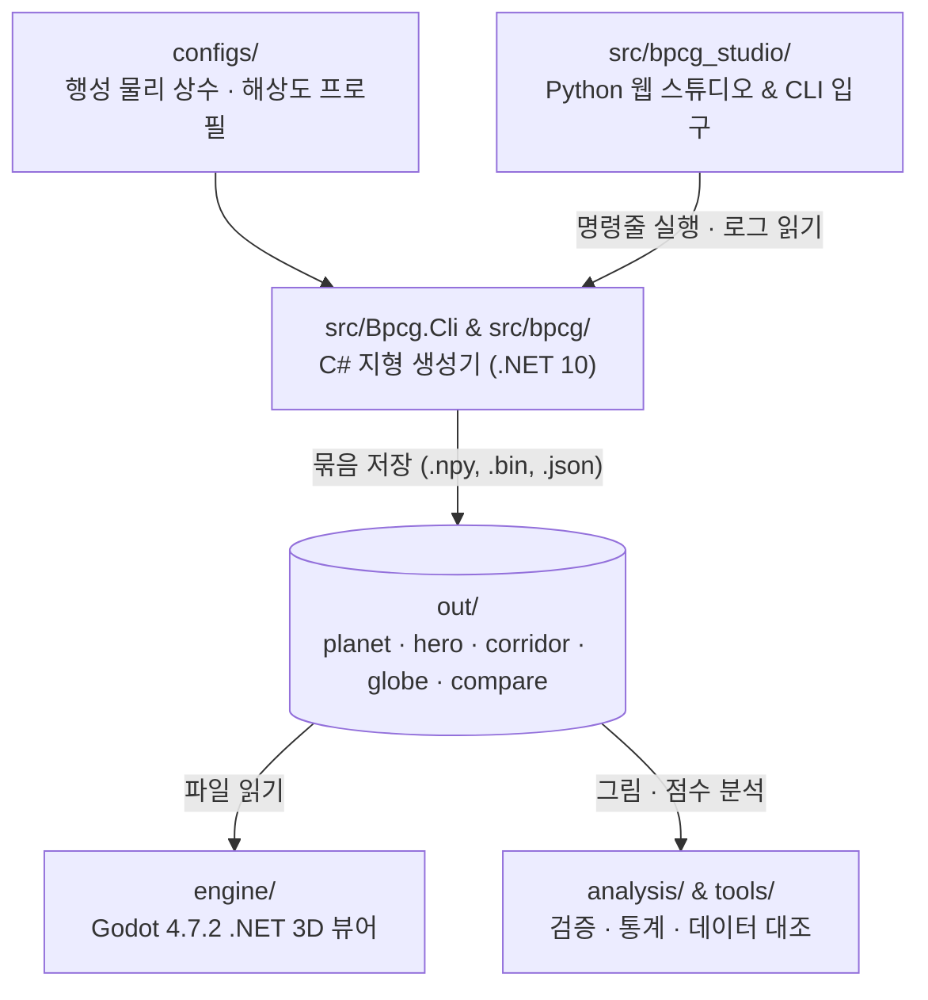

# 코드베이스 구조와 작동 원리 안내서

> 이 문서는 B-PCG 저장소가 무엇을 만드는 프로젝트이고, 코드가 어떤 순서와 원리로 돌아가는지 처음부터 끝까지 설명합니다. 판 운동·기후·암석에서 출발해 행성 전체(약 19.5 km 간격)부터 걸어 다니는 땅(2 m 간격)까지 세 단계 해상도로 지형과 땅속 구조를 일관되게 계산합니다. 행성 크기가 지구 반지름의 4분의 1(약 1,500 km)보다 작아지거나 땅이 물이 새지 않는 통돌이면 이 문서의 기본 가정과 결과가 달라집니다.

---

## 직접 돌려 보기

저장소 루트에서 아래 명령을 차례로 복사해 실행하면, 가장 작은 설정으로 행성부터 3D 뷰어용 파일까지 만들고 비교 도구까지 확인할 수 있습니다.

```bash
# 1. 가장 작은 프로필(tiny)로 행성 → 히어로 유역 → 회랑 → 지구본 한 번에 만들기
dotnet run --project src/Bpcg.Cli -c Release -- all --profile tiny --out out/tiny

# 2. 만든 결과로 검증 그림 9장과 요약표 뽑기
dotnet run --project src/Bpcg.Cli -c Release -- figures results out/tiny

# 3. 지형 생성 방법 12가지를 64 × 64 격자에서 한 번에 돌리고 표로 비교하기
dotnet run --project src/Bpcg.Cli -c Release -- compare run --param grid.n=64 --seeds 0 --out out/compare/try
dotnet run --project src/Bpcg.Cli -c Release -- compare list --set try
```

- 맞게 돌았으면:
  - 1번 명령 끝에 `[전체] 끝: 1.2 s → out/tiny`가 출력되고, `out/tiny/planet/`, `out/tiny/hero/`, `out/tiny/corridor/`, `out/tiny/globe/` 네 폴더와 점수표(`scorecard.json`)가 생깁니다.
  - 2번 명령 끝에 `그림을 썼습니다: out/tiny/figures`가 출력되고, `planet_layers.png`, `hero_map.png`, `cross_section.png` 등 그림 9장이 생깁니다.
  - 3번 명령 끝에 `[비교] 끝: 0.5 s → out/compare/try`가 출력되고, `compare list`를 실행하면 12가지 방법의 기복·웅덩이 넓이·하천 밀도 비교표가 터미널에 나타납니다.
- 걸리는 시간: 1번 약 1.2초, 2번 약 10초, 3번 약 0.5초 (Release 빌드, Apple Silicon 맥 기준).

---

## 1. 이 프로젝트가 하는 일과 핵심 아이디어

### 1.1 왜 노이즈 대신 물리 법칙으로 지형을 푸는가

기존 절차적 지형 생성기는 대부분 무작위 무늬(노이즈)를 여러 겹 포개 산처럼 보이는 울퉁불퉁한 면을 만듭니다. 그 방법은 빠르지만 두 가지 한계가 있습니다.

1. **물길이 이어지지 않습니다.** 노이즈로 만든 땅에 빗물을 흘려보내면 사방이 막힌 웅덩이(사방이 더 높은 땅에 막혀 물이 고이는 자리)에 물이 갇혀 바다까지 내려가지 못합니다.
2. **땅 위와 땅속이 따로 놉니다.** 산 모양을 먼저 그리고 강·호수·동굴·지층을 나중에 덧칠하기 때문에, 왜 거기에 절벽이 서고 왜 그 높이에 동굴이 뚫렸는지 앞뒤가 맞지 않습니다.

B-PCG는 무작위 무늬를 쌓는 대신 **땅이 솟아오르는 힘, 비가 내려 흐르는 물길, 암석의 단단함**이라는 세 가지 물리 조건에서 출발합니다.

### 1.2 수천만 년을 기다리지 않고 '다 자란 모양'만 바로 구하기

실제 산맥은 수백만 년에서 수천만 년에 걸쳐 자랍니다. 이를 1년 단위로 쪼개 시간 순서대로 계산하면, 행성 하나를 만드는 데 몇 시간이 걸립니다.

그런데 오래 자란 산은 어느 순간부터 높이가 거의 바뀌지 않습니다. 땅이 밑에서 솟아오르는 속도와 강물이 위에서 깎아 내리는 속도가 같아지기 때문입니다. 이 프로젝트는 시간 순서로 땅을 깎는 대신, 처음부터 솟는 속도와 깎이는 속도가 비기는 정상상태(땅이 솟는 속도와 강이 깎는 속도가 같아져 높이가 더 바뀌지 않는 상태) 방정식을 직접 풉니다. 바다 해안선(`0 m`)에서 출발해 상류로 한 칸씩 거슬러 올라가며, 그 칸에 모인 물의 양과 암석 종류에 맞는 경사를 차곡차곡 더해 높이를 구합니다.

### 1.3 행성 전체에서 발밑까지 이어지는 3단계 해상도 사다리

지구만 한 행성 전체를 사람 키 수준(2 m)의 촘촘한 격자로 한 번에 나누면 칸 수가 약 1,280억 개에 달해 일반 컴퓨터 메모리에 들어가지 않습니다. 그래서 B-PCG는 해상도를 세 단계로 나누어 필요한 곳만 확대합니다.

| 단계 이름 | 코드 표기 | 다루는 범위 | 칸 간격 (`laptop` 기준) | 칸 개수 | 일상 크기 비유 |
|---|---|---|---|---|---|
| 1단계: 행성 전체 지도 | `L0` | 반지름 6,371 km 구면 전체 | 약 19.5 km | $6 \times 512^2 = 1,572,864$칸 | 칸 하나가 서울 남북 길이(30 km)의 3분의 2 |
| 2단계: 정밀 유역 지도 | `L2` | 히어로 유역(행성에서 골라 25 m 간격으로 다시 푼 강 유역 하나) $32\text{ km} \times 32\text{ km}$ | 25 m | $1280 \times 1280 = 1,638,400$칸 | 전체는 서울만 한 네모, 칸 하나는 25 m 수영장 레인 길이 |
| 3단계: 3D 보행 세계 | `L3` | 회랑(히어로 유역 안에서 골라 사람이 걸어 다니는 6 km × 1 km 땅) | 높이맵 2 m / 지층 부피 4 m | $3000 \times 500$칸 (높이맵) | 전체 넓이는 여의도의 약 2배, 칸 하나는 사람 키 정도 |

위 단계(`L0`)에서 구한 판 경계 융기 속도, 강수량, 3D 지층 모델, 유역 경계 높이를 아래 단계(`L2`, `L3`)가 그대로 물려받아 다시 풀기 때문에, 우주에서 본 산맥과 걸어 다니며 보는 절벽·동굴이 한 줄기로 맞물립니다.

---

## 2. 코드베이스 전체 구조와 역할 분담

이 저장소는 크게 **C# 지형 생성기**, **Godot 3D 뷰어**, **Python 웹 스튜디오 및 분석 스크립트** 세 부분으로 나뉩니다. 세 부분은 메모리를 직접 공유하지 않고, 디스크에 저장된 묶음(한 단계가 만든 지도 파일과 목차를 한 폴더에 모은 결과물) 폴더를 주고받으며 소통합니다.



### 2.1 폴더별 핵심 파일과 역할

| 폴더 / 프로젝트 | 언어 | 하는 일 | 핵심 파일 |
|---|---|---|---|
| `src/bpcg/` (`Bpcg.csproj`) | C# (.NET 10) | 행성·히어로 유역·회랑·지구본을 계산하고 파일로 굽는 핵심 라이브러리 | `Pipeline.cs`, `Runs.cs`, `Config.cs` |
| `src/Bpcg.Cli/` (`Bpcg.Cli.csproj`) | C# (.NET 10) | `planet`, `hero`, `bake`, `globe`, `all`, `figures`, `compare` 명령을 실행하는 콘솔 입구 | `Program.cs`, `CompareCmd.cs`, `Figures.cs` |
| `engine/` (`Bpcg.Engine.csproj`) | C# (Godot 4.7.2) | 구운 회랑과 지구본을 3D로 보여 주고 걸어 다니며 단면을 자르는 뷰어 | `CorridorViewer.cs`, `TerrainChunk.cs`, `CutawayPlane.cs`, `GlobeRoot.cs` |
| `src/bpcg_studio/` | Python 3.12+ | 웹 브라우저에서 설정을 바꾸고 지도를 뜯어보는 로컬 스튜디오(`127.0.0.1:8765`)와 `bpcg` 래퍼 | `cli.py`, `server.py`, `params.py`, `bundle_Penalty.py` |
| `configs/` | TOML | 지구 물리 상수(`planets/earth.toml`), 해상도 프로필(`profiles/`), 비교 설정(`compare/`) | `earth.toml`, `laptop.toml`, `tiny.toml` |
| `tests/` | C# & Python | C# 단위·정답 대조 시험(`tests/Bpcg.Tests/`)과 Python 통합·스튜디오·엔진 시험(`tests/test_*.py`) | `Golden.cs`, `test_pipeline.py`, `test_engine.py` |
| `analysis/` & `data/` | Python | 실제 지구 지형·하천·지하수·숲 레이더 자료(`data/pilot/`)를 읽고 생성 결과와 대조하는 스크립트 | `scale_ladder_calcs.py`, `dem_catalog/` |
| `tools/` | Python | 개발 환경 점검(`doctor.py`), 파일럿 데이터 내려받기(`download_pilot.py`), 물리 타당성 감사(`plausibility_audit.py`) | `doctor.py`, `download_pilot.py` |

### 2.2 `src/bpcg/` 내부 모듈 지도

C# 생성기 라이브러리(`src/bpcg/`)는 계산 단계에 따라 아홉 개 하위 폴더로 나뉩니다.

1. **`Core/`**: 큐브스피어(주사위 여섯 면을 부풀려 공 모양으로 만든 격자)와 평면 격자(`Cubesphere.cs`, `Graph.cs`), 구면 보간(`Resample.cs`), 대원 거리 계산(`Distance.cs`), 시드(난수 계산기가 출발점으로 삼는 번호)에서 난수를 뽑는 `Rng.cs`, 배열을 `.npy`/`.npz`로 읽고 쓰는 `Npy.cs`.
2. **`Numerics/`**: 운영체제나 CPU가 달라도 똑같은 실수 계산 결과를 내도록 보장하는 수학 함수(`NpMath.cs`), 짝지어 더하기(`NpReduce.cs`), 3차원 벡터 연산(`LinAlg.cs`).
3. **`Planet/`**: 판 경계와 융기 속도(`Tectonics.cs`), 해수면과 대륙붕(`Isostasy.cs`), 바람과 지형성 강수(`Climate.cs`)를 만드는 1단계 모듈.
4. **`Geology/`**: 6가지 암석 물성표(`Rocks.cs`), 땅속 3차원 지층 기둥과 습곡·단층·경사(`Column.cs`, `Templates.cs`).
5. **`Hydro/`**: 웅덩이를 메우는 `Depressions.cs`, 물이 흘러갈 이웃을 고르는 `Routing.cs`, 상류부터 물과 퇴적물을 합산하는 `Accumulate.cs`, 유역과 강 구간을 묶는 `Network.cs`.
6. **`Landscape/`**: 지형 높이를 구하는 솔버(지형 높이를 구하는 계산기)인 `Solver.cs`, 산골짜기 입구에 흙을 쌓는 `Fans.cs`, 큰 칸 안의 작은 기복을 추정하는 `Relief.cs`.
7. **`Subsurface/`**: 호수·강 수면과 바닥 높이(`Water.cs`), 토양·퇴적층 두께(`Sediment.cs`), 지하수면(땅속 빈틈이 물로 가득 차기 시작하는 높이)을 푸는 `WaterTable.cs`, 석회암 동굴 층을 뚫는 `Caves.cs`.
8. **`Hero/` & `Volume/`**: 행성에서 가장 흥미로운 유역을 고르는 `Finder.cs`, 구면 조각을 평면 격자로 펴는 `Domain.cs`, 임의의 $(x, y, z)$ 점이 공기·물·어떤 암석인지 판정하는 `Sample.cs`(`HeroVolume`).
9. **`Bake/`, `Metrics/`, `Compare/`**: Godot 엔진이 읽을 파일을 굽는 `Corridor.cs`와 `Globe.cs`, 29개 검증 항목을 채점하는 `Scorecard.cs`, 12가지 지형 생성법을 같은 격자에서 맞비교하는 `CompareRunner.cs`.

---

## 3. 세 갈래 인과 사슬과 4단계 생성 파이프라인

생성 파이프라인(`src/bpcg/Pipeline.cs`)은 세 갈래 인과 사슬을 따라 총 4단계로 지형을 만듭니다.


---

### 3.1 1단계: 행성 재료와 3D 지층 만들기 (`Planet/` & `Geology/`)

#### ① 큐브스피어 격자와 노드 흔들기 (`Core/Cubesphere.cs`, `Core/Graph.cs`)

공 모양 행성에 일반 위도·경도 격자를 씌우면 북극과 남극 근처에서 칸들이 바늘처럼 좁아져 계산이 깨집니다. 그래서 주사위 여섯 면($+X, -X, +Y, -Y, +Z, -Z$)을 각각 $n \times n$ 칸으로 나눈 뒤 공 모양으로 부풀린 큐브스피어를 씁니다. 각도를 똑같이 나누는 탄젠트 투영($u = \tan(\frac{\pi}{4}\xi)$)을 써서 면 한가운데와 모서리의 칸 넓이 차이가 크지 않습니다.

바둑판처럼 줄 맞춰 선 칸에서 이웃 여덟 칸으로만 물을 흘리면 강이 가로·세로·$45^\circ$ 대각선으로만 곧게 뻗는 문제가 생깁니다. 이를 막기 위해 노드 흔들기(격자 줄무늬가 드러나지 않도록 칸 중심을 조금씩 옮기는 일)를 적용합니다. `jitter = 1.0`이면 각 칸 중심을 가로·세로 최대 반 칸($\pm 0.5$칸)까지 무작위로 흔들고, 흔들린 실제 3차원 거리 $d_{cc'}$를 계산해 모든 경사 식에 씁니다.

#### ② 판 운동과 거친 지각 평형 (`Planet/Tectonics.cs`, `Planet/Isostasy.cs`)

먼저 거친 구면 격자(`coarse_n`, `laptop` 기준 면당 $128 \times 128$칸, 칸 간격 약 78 km로 제주도 동서 길이보다 조금 김)에서 대륙판과 해양판 씨앗을 뿌려 보로노이 판을 나눕니다. 판마다 회전축과 각속도를 주어 판 경계에서 두 판이 부딪치는지(수렴), 갈라지는지(발산), 스쳐 지나가는지(변환) 판정합니다.

판이 부딪치는 경계에서는 산맥이 솟아오르는 융기 속도 $U$($\text{m/yr}$, 최대 $5\text{ mm/yr}$로 1,000년에 5 m)가 커지고, 판 안쪽 안정된 대륙에서는 $0.05\text{ mm/yr}$로 낮아집니다. 이어서 대륙 지각과 해양 지각의 두께·밀도 차이로 초기 고도를 어림잡고, 지구 바다 물 부피($1.335 \times 10^{18}\text{ m}^3$)를 채웠을 때 잠기는 높이를 해수면으로 잡아 바다 칸과 육지 칸을 나눕니다.

#### ③ 바람과 비그늘 기후 (`Planet/Climate.cs`)

위도에 따라 부는 무역풍·편서풍·극동풍과 기본 강수량에 더해, 바람이 바다에서 수증기를 머금고 불어오다 산맥을 넘을 때 비를 쏟고 산 너머는 건조해지는 비그늘 효과를 계산합니다. 바람이 불어가는 방향으로 한 걸음씩 나아가며 공기 중 수증기 양 $q$를 추적합니다.

바람이 오르막($\max(\nabla z \cdot \mathbf{w}, 0)$)을 만나면 수증기가 비로 바뀌어 강수량 $P$가 늘어나고, 산을 넘어 내리막을 타면 남은 수증기가 적어 건조해집니다. 강수량 $P$에서 잠재 증발산량 $\text{PET}$를 버디코(Budyko) 곡선으로 빼서 실제로 강으로 흘러드는 유효 유출량 $R_{\text{eff}}$($\text{m/yr}$)를 얻습니다.

#### ④ 3D 지층 기둥과 6가지 암석 (`Geology/Rocks.cs`, `Geology/Column.cs`)

지형이 다 만들어진 뒤 표면에 줄무늬를 칠하는 대신, 지형을 깎기 전에 행성 전체를 관통하는 3차원 지층 구조(`GeologyModel`)를 먼저 세웁니다. 암석은 모두 여섯 가지이며, 각각 깎이기 쉬운 정도($K$), 비탈이 무너지지 않고 버티는 최대 기울기($S_{\text{crit}}$), 물이 스며드는 투수율($k_{\text{perm}}$), 물에 녹는지 여부(`soluble`)가 다릅니다.

| 번호 | 암석 이름 | 깎임 계수 $K$ ($\text{yr}^{-1}$) | 임계 경사 $S_{\text{crit}}$ (각도) | 물에 녹는가 | 지형에서 나타나는 특징 |
|---|---|---|---|---|---|
| 0 | 결정질 기반암 (화강암·편마암) | $2.5 \times 10^{-6}$ | $0.85$ (약 $40^\circ$) | 아니요 | 가장 단단함. 깎이지 않고 높은 산봉우리와 험준한 능선을 이룸 |
| 1 | 사암 | $6.0 \times 10^{-6}$ | $0.75$ (약 $37^\circ$) | 아니요 | 단단한 절벽 층을 이루며 계단식 단차(천이점)를 만듦 |
| 2 | 석회암 (탄산염암) | $8.0 \times 10^{-6}$ | $0.70$ (약 $35^\circ$) | **예** | 지하수에 녹아 카르스트 지형과 2단 동굴 통로가 뚫림 |
| 3 | 이암·셰일 | $2.0 \times 10^{-5}$ | $0.45$ (약 $24^\circ$) | 아니요 | 무르고 쉽게 깎여 완만한 비탈과 넓은 골짜기를 만듦 |
| 4 | 화산암 (현무암) | $5.0 \times 10^{-6}$ | $0.80$ (약 $39^\circ$) | 아니요 | 판 경계 화산 지대를 덮는 단단한 용암 대지 층 |
| 5 | 미고결 퇴적물 (모래·자갈) | $5.0 \times 10^{-5}$ | $0.35$ (약 $19^\circ$) | 아니요 | 강바닥, 선상지, 평야에 새로 쌓인 흙 층 |

각 칸 $(x, y)$마다 바닥 기반암 위에 사암·석회암·셰일 층이 교대로 쌓인 지층 기둥을 두되, 판 경계 거리에 따라 지층이 휘어지는 습곡(`fold_amp_m = 250 m`)과 끊어져 어긋나는 단층(`fault_throw_m = 180 m`)을 넣어 땅속 지층 경계면 높이 $z_{\text{bottom}}(c, l)$을 결정합니다.

---

### 3.2 2단계: 정상상태 지형과 물길 풀기 (`Hydro/` & `Landscape/`)

2단계는 이 프로젝트의 심장부인 `Solver.SolveSteadyState`(`src/bpcg/landscape/Solver.cs`)가 맡습니다. 물길은 땅 높이를 따라 흐르고, 땅 높이는 물길을 따라 쌓이므로 두 값을 한 번에 알 수 없습니다. 그래서 물길 방향이 더 이상 바뀌지 않을 때까지 다섯 걸음(①~⑤)을 되풀이합니다.

```text
2단계: 산과 강의 모양 풀기 (SolveSteadyState)
  ① 물이 갇히는 웅덩이를 메워 모든 칸이 바다(또는 출구)로 이어지게 함 (Priority-Flood)
  ② 칸마다 여덟 이웃 가운데 가장 가파른 내리막 이웃 하나를 수신 칸으로 고름 (D8 + 히스테리시스)
  ③ 상류에서 하류로 내려가며 물의 양(Q)과 흙의 양(Qs)을 더함
  ④ 물의 양·흙의 양·암석 종류로 각 칸이 가져야 할 평형 경사 S를 계산함
  ⑤ 바다(0 m)에서 상류로 거슬러 올라가며 지층 경계마다 경사를 쌓아 새 높이 z를 구함
  → ⑤에서 구한 새 높이 때문에 ②의 물길이 바뀌면 다시 ①로 돌아가고, 안 바뀌면 멈춤
```

#### ① 웅덩이 메우기 (`Hydro/Depressions.cs`)

현재 높이 $z$에 빗물을 흘렸을 때 사방이 막혀 물이 고이는 웅덩이가 있으면 상류에서 하류까지 물길이 끊깁니다. 바다(출구) 칸들을 우선순위 큐(힙)에 넣고 낮은 칸부터 안쪽으로 파고들며, 웅덩이에 갇힌 칸의 높이를 출구 턱 높이보다 아주 조금($\varepsilon \approx 10^{-4}\text{ m}$) 높여 모든 육지 칸이 바다까지 막힘없이 이어지게 만듭니다.

#### ② 물길 방향 고르기와 진동 방지 장치 (`Hydro/Routing.cs`)

각 칸 $c$는 이웃 칸들 가운데 경사 $(z_c - z_n) / d_{cn}$이 가장 가파른 이웃 하나를 수신 칸(물이 흘러 들어가는 이웃 칸) $r(c)$로 고릅니다(D8 라우팅).

이때 두 이웃의 경사가 비슷하면 반복할 때마다 물길이 왼쪽·오른쪽으로 왔다 갔다 뒤집히며 영원히 끝나지 않을 수 있습니다. 이를 막기 위해 두 가지 장치를 씁니다.
- **히스테리시스(`eta_hysteresis = 0.02`)**: 새 이웃의 경사가 직전 반복에서 쓰던 이웃의 경사보다 $2\%$ 초과해 가파를 때만 물길 방향을 바꿉니다.
- **진동 감지와 방향 고정(`oscillation_window = 6`, `freeze_after = 20`)**: 20번 넘게 반복한 뒤에도 최근 6번 안에 이전에 썼던 수신 칸으로 되돌아가는 칸이 있으면, 그 칸은 경사가 엇비슷한 분수령 안장점으로 보고 수신 칸 방향을 그 자리에 고정합니다.

#### ③ 상류 유량과 퇴적물 누적 (`Hydro/Accumulate.cs`)

모든 칸이 수신 칸 하나씩만 가리키므로, 물길은 순환이 없는 트리(방향 비순환 그래프)를 이룹니다. 바다에서 가까운 하류부터 상류 순으로 정렬한 배열(`order`)을 거꾸로 읽으면, 상류 산꼭대기부터 하류 바다까지 한 번에 값을 누적할 수 있습니다. 각 칸의 집수 넓이(한 칸으로 빗물을 모아 주는 상류 땅의 넓이) $A_c$, 유량(상류에서 모여 한 칸을 지나가는 물의 양) $Q_c$, 퇴적물 유량 $Q_{s,c}$를 아래처럼 더합니다.

$$Q_c = A_{\text{cell},c} \cdot R_{\text{eff},c} + \sum_{d \in \text{donors}(c)} Q_d$$

- $Q_c$: 칸 $c$를 지나가는 연평균 유량 ($\text{m}^3/\text{yr}$)
- $A_{\text{cell},c}$: 칸 $c$ 자체의 넓이 ($\text{m}^2$)
- $R_{\text{eff},c}$: 칸 $c$의 유효 유출량 ($\text{m}/\text{yr}$)
- $\text{donors}(c)$: 칸 $c$를 수신 칸으로 삼는 직전 상류 이웃 칸들의 모임

#### ④ 강 경사와 산비탈 경사를 매끄럽게 잇는 평형 경사 식 (`Landscape/Solver.cs`)

물이 많이 모인 골짜기 바닥은 강물이 바위를 깎고(하천 침식), 물이 거의 모이지 않는 산꼭대기 능선은 흙이 미끄러지며 깎입니다(사면 확산과 안식각 한계). 두 구간을 인위적인 문턱으로 자르면 지형에 부자연스러운 꺾임이 생기므로, 전환 유량 $Q^*$를 기준으로 두 경사를 매끄럽게 이어 붙입니다.

먼저 물이 충분히 모인 강의 기본 침식 경사 $S_{\text{fluvial}}$은 스트림 파워 법칙(Stream Power Law)에 강이 실어 온 흙이 바닥에 도로 쌓이는 효과(퇴적 계수 $G$)를 더한 식입니다.

$$S_{\text{fluvial}}(c, l) = k_s(c, l) \cdot Q_c^{-\theta} \cdot \left(1 + \frac{G \cdot Q_{s,c}}{U_c \cdot Q_c}\right)^{1/n}$$

- $S_{\text{fluvial}}(c, l)$: 칸 $c$의 지층 $l$에서 강물이 융기 속도와 비기는 경사 ($\text{m/m}$, 무차원)
- $k_s(c, l) = (U_c / K_l)^{1/n}$: 융기 속도 $U_c$($\text{m/yr}$)를 지층 $l$의 암석 침식 계수 $K_l$($\text{yr}^{-1}$)로 나눈 급경사 지수 ($\text{m}^{3\theta}\text{yr}^{-\theta}$)
- $Q_c$: 칸 $c$의 유량 ($\text{m}^3/\text{yr}$)
- $\theta = m/n = 0.45$: 하천 오목도 지수 (무차원, $m=0.45, n=1.0$)
- $G$: 퇴적 계수 (무차원, 행성 `L0`에서는 물길 진동을 막으려고 $0.0$, 히어로 `L2`에서는 $1.0$)
- $Q_{s,c}$: 상류에서 내려온 퇴적물 양 ($\text{m}^3/\text{yr}$)

여기에 산꼭대기 능선이 뾰족하게 치솟지 않도록 암석 임계 경사 $S_{\text{crit}, l}$을 점근선으로 삼아 강 경사와 산비탈 경사를 하나로 묶습니다.

$$S(c, l) = \frac{S_{\text{crit}, l} \cdot S_{\text{fluvial}}(c, l)}{\left(S_{\text{crit}, l}^p + S_{\text{fluvial}}(c, l)^p\right)^{1/p}} \cdot \tanh\!\left(\left(\frac{Q_c}{Q^*}\right)^\gamma\right)$$

- $S(c, l)$: 칸 $c$의 지층 $l$이 실제로 갖는 최종 평형 경사 ($\text{m/m}$)
- $S_{\text{crit}, l}$: 지층 $l$의 암석이 무너지지 않고 버티는 최대 경사 ($\text{m/m}$, 예: 사암 $0.75$, 셰일 $0.45$)
- $p = 4.0$: 강 경사에서 임계 경사로 넘어가는 모서리의 날카로움을 정하는 지수 (무차원)
- $Q^*$: 산비탈에서 강으로 성질이 바뀌는 전환 유량 ($\text{m}^3/\text{yr}$)
- $\gamma = 0.5$: 산꼭대기 분수령에서 경사가 $0$으로 부드럽게 줄어들게 하는 지수 (무차원)

예를 들어 유량 $Q_c$가 아주 큰 하류 본류에서는 $S_{\text{fluvial}}$이 $0.005$(1 km 갈 때 5 m 오름)처럼 작아져 완만한 강바닥이 되고, 상류 절벽으로 갈수록 $S(c, l)$이 커지다가도 암석의 $S_{\text{crit}, l}$을 절대 넘지 않습니다. 그리고 분수령 꼭대기($Q_c \ll Q^*$)에서는 $\tanh$ 항 덕분에 능선이 둥글게 마무리됩니다.

#### ⑤ 지층 경계를 따라 구간별로 높이 쌓기 (`IntegrateStrata`)

만약 한 칸에서 상류 이웃 칸으로 올라가는 동안 지층 경계면을 지나친다면 어떻게 될까요? 아래쪽 절반은 무른 셰일($S = 0.3$)이고 위쪽 절반은 단단한 사암($S = 0.7$)인데 한 가지 경사만 쓰면, 지층과 지형이 따로 놀게 됩니다.

그래서 `IntegrateStrata`는 하류 수신 칸 높이 $z_{r(c)}$에서 출발해 두 칸 사이 수평 거리 $d$를 걸어 올라가면서, 지층 경계면 $z_{\text{bottom}}(c, l)$을 만날 때마다 남은 거리를 그 지층의 경사 $S(c, l)$로 쪼개 적분합니다. 이 덕분에 무른 셰일 층 위를 흐르던 강이 단단한 사암 층을 만나는 자리에서 경사가 갑자기 가팔라지는 폭포·급류 구간(천이점, knickpoint)이 저절로 만들어집니다.

#### ⑥ 지각 세기 한계, 선상지, 아격자 기복 (`Landscape/Fans.cs`, `Landscape/Relief.cs`)

- **지각 세기 한계(`max_elevation_m = 5500 m`)**: 지구 지각은 무게를 견디는 한계가 있어 백두산(2,744 m)의 약 2배인 5,500 m보다 훨씬 높은 산은 자기 무게에 눌려 무너집니다. 수렴 후 높이가 5,500 m를 넘는 곳은 지각 한계 곡선으로 부드럽게 눌러 줍니다.
- **선상지(`Fans.cs`)**: 히어로 유역(`L2`)처럼 촘촘한 격자에서는 산골짜기를 빠져나온 강이 평야를 만날 때 경사가 갑자기 완만해져 실어 온 흙을 다 나르지 못하고 부채 모양으로 쌓는 선상지(산골짜기 입구에 흙이 부채 모양으로 쌓인 지형)가 생깁니다. 골짜기 출구에서 안식각(`fan_alpha = 1.5`)을 따라 흙을 쌓아 올린 뒤 물길을 한 번 더 갱신합니다.
- **아격자 기복(`Relief.cs`)**: 행성 지도(`L0`)의 칸 하나(19.5 km)는 너무 넓어서 칸의 평균 고도 $z_{\text{mean}}$만 구하면 그 안에 있는 작은 봉우리와 깊은 골짜기가 사라집니다. 그래서 칸 안의 융기 속도와 암석 물성으로 아격자 기복(큰 칸 하나 안에 숨어 있는 작은 산과 골짜기의 높이 차)을 해석적으로 계산해 칸 내 최저 높이($z_{\text{min}}$)와 최고 높이($z_{\text{max}}$)를 함께 기록합니다.

---

### 3.3 3단계: 땅속 물·토양·지하수면·동굴 만들기 (`Subsurface/`)

지표면 높이 $z$와 물길이 정해지면, 같은 인과 사슬을 땅속으로 이어 내려갑니다.

1. **호수와 강 수면(`Subsurface/Water.cs`)**: 유량 $Q_c$가 기준(`q_river_m3_per_yr`, 행성 $10^8$, 히어로 $3 \times 10^5\text{ m}^3/\text{yr}$) 이상인 칸을 강으로 표시합니다. 수력 기하학 식($w = k_w Q^{b_w}$, $d = k_d Q^{b_d}$, 레오폴드·매독 지수 $b_w = 0.5, b_d = 0.4$)으로 강폭과 수심을 구해 강바닥 높이(`bed_m`)와 수면 높이(`water_level_m`)를 정합니다.
2. **토양과 퇴적물 두께(`Subsurface/Sediment.cs`)**: 완만한 평야에는 강이 내려놓은 충적토가 두껍게 쌓이고, 가파른 비탈에는 기반암이 풍화된 얇은 흙만 남습니다. 경사 $S_c$가 임계 경사 $S_{\text{crit}}$에 가까워질수록 토양 두께가 $0\text{ m}$로 줄어들어 가파른 절벽에는 맨바위가 드러납니다.
3. **지하수면(`Subsurface/WaterTable.cs`)**: 비가 땅속으로 스며드는 함양량($R_{\text{gw}} = f_{\text{recharge}} \cdot R_{\text{eff}}$)과 지층의 투수율 $T$로 부시네스크(Boussinesq) 지하수 방정식을 풀어 지하수면 높이 $z_{\text{gw}}$를 구합니다. 강과 호수 칸에서는 지하수면이 수면 높이와 정확히 만나고, 산능선으로 올라갈수록 땅속을 따라 완만하게 높아지되 지표면 위로 솟아오르지 않도록($z_{\text{gw}} \le z$) 묶습니다.
4. **석회암 2단 동굴(`Subsurface/Caves.cs`)**: 동굴은 아무 데나 뚫지 않습니다. 오직 물에 녹는 **석회암(`soluble = true`)** 지층이 지하수면 근처를 지나는 자리에서만 생깁니다.
   - **아래층 동굴(`cave_level_0_m`)**: 현재 지하수면 바로 아래에서 지금도 지하수가 흐르며 바위를 녹이고 있는 활성 동굴 통로입니다.
   - **위층 동굴(`cave_level_1_m`)**: 과거에 땅이 덜 솟아올랐을 때 옛 지하수면 자리에서 뚫렸다가, 그 뒤 땅이 $\Delta t_{\text{cave}} \cdot U_c$(기본 30만 년 동안 솟은 높이)만큼 융기하면서 물이 빠진 마른 화석 동굴 통로입니다.

---

### 3.4 4단계: 히어로 유역(`L2`) 찾기와 회랑(`L3`) 3D 굽기 (`Hero/`, `Volume/`, `Bake/`)

#### ① 히어로 유역 자동 선택과 25 m 재풀이 (`Hero/Finder.cs`, `Pipeline.cs`)

행성 전체(`L0`) 계산이 끝나면, `Finder.FindHeroCandidates`가 행성의 육지 유역들을 훑으며 가장 볼거리가 풍부한 후보지를 채점합니다.
- 유역 안에 솟아오르는 속도의 차이(융기 기울기)가 커서 높은 산과 평야가 함께 있는지
- 석회암이 지표와 지하에 골고루 분포해 동굴과 절벽이 함께 나타나는지
- 단층이 지나가고 충분한 유량의 본류 강이 흐르는지

가장 점수가 높은 유역 중심에 $32\text{ km} \times 32\text{ km}$ 접평면 격자(`L2`, 칸 간격 25 m)를 깝니다. 이때 `L2`를 처음부터 따로 만드는 것이 아니라, 행성 `L0`에서 구한 융기율·강수량·3D 지층 모델을 25 m 격자로 보간해 가져오고, 네 변 가장자리 높이를 `L0` 높이에 고정한 뒤, 상류 밖에서 유역 안으로 흘러 들어오는 강물(`inflow`)까지 경계 조건으로 넣어 2~3단계 솔버를 25 m 해상도로 다시 풉니다.

#### ② 회랑 선택과 3D 재질 부피 굽기 (`Bake/Corridor.cs`, `Volume/Sample.cs`)

히어로 유역(`L2`)이 완성되면, 그 안에서 강과 산비탈·석회암 동굴이 가장 잘 만나는 $6\text{ km} \times 1\text{ km}$ 직사각형 띠인 회랑을 자동으로 고릅니다(`PickCorridor`).

그다음 회랑 영역을 2 m 간격(`nx = 3000, ny = 500`)으로 촘촘히 쪼개 지표면 높이맵(`heightmap.f32`)과 지하수면(`water_table.f32`)을 굽습니다. 이때 25 m 격자 사이를 메우는 미세한 바위 결과 비탈 주름(`Detail.SynthesizeDetail`)을 더하되, 본류 강바닥을 가로막아 물이 역류하지 않도록 강바닥 근처에서는 미세 기복을 눌러 줍니다.

마지막으로 `HeroVolume.QueryGrid`(`Volume/Sample.cs`)가 회랑의 땅속 3차원 공간(`750 × 125 × 200` 복셀, 가로·세로 4 m, 높이 2 m 간격)을 훑으며 각 점 $(x, y, z)$가 무엇인지 바이트 번호(`strata.u8`)로 기록합니다.

```text
3D 샘플 판정 규칙 (HeroVolume): 점 (x, y, z)에 무엇이 있는가?
  1. z > 지표면 높이이고 z ≤ 수면 높이이면 → 물 (강 또는 호수, 코드 254)
  2. z > 지표면 높이이고 수면보다도 높으면 → 빈 공기 (코드 255)
  3. 땅속(z ≤ 지표면)인데 동굴 반지름 안에 들어오면 → 동굴 빈칸 (코드 253)
  4. 지표면 바로 아래 토양 두께 안이면 → 미고결 퇴적물·흙 (코드 5)
  5. 그보다 깊은 땅속이면 → 3D 지층 기둥에서 그 높이 z에 놓인 암석 종류 (코드 0~5)
```

---

## 4. 두 가지 비교·검증 장치: 점수표와 12가지 맞비교

### 4.1 29개 항목을 자동으로 채점하는 점수표 (`Metrics/Scorecard.cs`)

생성기가 행성과 히어로 유역을 다 만들면 `Scorecard.BuildScorecard`가 29개 물리·통계 지표를 계산해 `scorecard.json`에 씁니다. 이때 우리가 입력으로 넣어 준 조건 때문에 당연히 맞는 숫자와, 계산 결과 저절로 나타난 숫자를 섞어 놓으면 검증이 정직하지 못하므로 모든 지표를 세 종류(`kind`)로 구분합니다.

1. **`check` (코드·법칙 합격 판정)**: 물길 역류 칸 수(`0`이어야 합격), 물·퇴적물 수지 오차($10^{-6}$ 이하), 솔버가 찾은 경사와 평형 경사 식의 상대 오차($10^{-3}$ 이하), 석회암 밖에서 뚫린 동굴 수(`0`이어야 합격), 지하수면 규칙 위반(`0`이어야 합격), 격자 정렬 지수($1.3$ 미만) 등 **하나라도 틀리면 코드 버그로 보고 불합격(`pass: false`) 처리하는 항목**입니다.
2. **`forced` (입력이 정한 지표)**: 대륙·해양 지각 비율과 지각 평형 공식을 넣어 주었기 때문에 두 봉우리 간격이 벌어지는 고도 쌍봉 분포(`planet.hypsometry_bimodal`)처럼, 입력 조건이 직접 만든 값입니다.
3. **`emergent` (저절로 나온 창발 지표)**: 공식에 직접 넣은 적 없는데 솔버가 지형을 풀고 나니 결과로 나타난 값입니다. 예를 들어 강 유역 넓이 $A$와 본류 길이 $L$의 거듭제곱 관계인 헥의 법칙 지수(`hack_exponent`, $L \propto A^h$)는 식에 넣지 않았는데도 `tiny` 프로필에서 행성 $0.567$, 히어로 $0.561$, `laptop` 프로필에서 행성 $0.51$, 히어로 $0.56$이 나와 실제 지구 관측치($0.49 \sim 0.60$) 안에 들어옵니다.

### 4.2 기존 지형 생성법 11가지와의 맞비교 (`Compare/`)

`src/bpcg/Compare/`는 같은 평면 격자, 같은 시드, 같은 지표 계산기 위에서 B-PCG 평면 히어로와 기존 지형 생성 방법 11가지를 나란히 돌려 비교합니다.

방금 직접 돌린 $64 \times 64$ 격자(칸 간격 50 m, 시드 0) 실행 결과에서 대표 방법 다섯 가지를 추리면 다음과 같습니다.

| 방법 ID | 방식 분류 | 걸린 시간 | 기복 (m) | 웅덩이 넓이 (%) | 하천 밀도 ($\text{km/km}^2$) | 오목도 $\theta$ |
|---|---|---:|---:|---:|---:|---:|
| `fbm` | 기본 프랙탈 노이즈 | 0.005초 | 1,500 | 18.5% | 0.695 | 0.419 |
| `warped` | 좌표를 비튼 노이즈 | 0.001초 | 1,500 | 11.2% | 0.596 | -0.283 |
| `hydraulic` | 빗방울 입자 수력 침식 | 0.010초 | 1,315 | 7.42% | 0.504 | -0.183 |
| `stream_power` | 시간 적분 하천 침식 (250걸음) | 0.107초 | 655 | 0.20% | 0.925 | 1.24 |
| **`bpcg`** | **정상상태 솔버 + 3D 지층 (우리 방법)** | **0.063초** | **2,023** | **0%** | **0.715** | **0.382** |

노이즈 계열(`fbm`, `warped`)과 입자 침식(`hydraulic`)은 빠르지만 땅의 $7 \sim 18\%$가 물이 빠져나가지 못하는 웅덩이로 남고 강 종단면 오목도($\theta$)가 음수로 뒤집히기도 합니다. 시간 적분(`stream_power`)은 250걸음을 돌려도 아직 다 자라지 않아 오목도가 $1.24$로 과도하게 꺾이고 땅속 지층·지하수·동굴 정보가 없습니다. 반면 `bpcg`는 0.063초 만에 웅덩이 넓이 $0\%$, 자연스러운 오목도($0.382$)와 함께 땅속 지층·지하수면·동굴까지 한 번에 만듭니다.

---

## 5. 결정론과 수치 재현 장치

이 코드베이스는 **"시드와 설정이 같으면 언제 돌려도 비트 단위까지 같은 지형이 나온다"**는 규칙을 엄격하게 지킵니다.

1. **독립된 난수 스트림(`Core/Rng.cs`)**: 전역 난수 생성기를 쓰지 않습니다. 마스터 시드 번호에 단계 이름 문자열(예: `"tectonics"`, `"climate"`, `"hero_finder"`)을 붙여 `SplitMix64`로 섞은 뒤 `PCG64` 상태 두 개를 초기화합니다. 덕분에 기후 단계에서 난수를 몇 번 더 쓰더라도 판 운동이나 히어로 선택의 난수열이 전혀 흔들리지 않습니다.
2. **플랫폼 독립 부동소수점 연산(`Numerics/`)**: 일반 `.NET` 수학 함수나 배열 합산은 CPU 명령어(FMA, 단일 곱셈-누산)나 덧셈 순서에 따라 마지막 1~2비트가 달라질 수 있습니다. 작은 높이 차이($10^{-16}\text{ m}$) 하나가 D8 물길 방향을 바꾸면 하류 유량과 산 모양 전체가 달라지기 때문에, `NpReduce.Sum`은 배열을 반씩 쪼개 더하는 짝지어 더하기(Pairwise summation)를 쓰고, `LinAlg.cs`는 FMA를 쓰지 않도록 곱셈과 덧셈 순서를 고정했습니다.
3. **고정 정답 대조 시험(`tests/golden/data/` & `tests/Bpcg.Tests/`)**: `tests/golden/data/`에는 격자·수계·솔버·기후·지질의 입력과 정답 배열이 이진 파일로 들어 있습니다. `dotnet test`를 실행하면 182개 단위 시험이 현재 C# 계산 결과와 정답 파일을 대조해 실수 오차가 한계(1~4 ulp)를 넘는지 자동으로 검사합니다.

---

## 6. Godot 3D 뷰어와 웹 스튜디오 작동 방식

### 6.1 Godot 4.7.2 .NET 3D 뷰어 (`engine/`)

`engine/` 프로젝트는 생성기를 다시 돌리지 않고, C# 생성기가 디스크에 구워 놓은 파일만 읽어 두 가지 화면을 렌더링합니다.

- **회랑 뷰어(`Scenes/Corridor.tscn`, `Scripts/CorridorViewer.cs`)**: `out/<실행>/corridor/` 폴더에서 2 m 높이맵(`heightmap.f32`), 지표 재질(`surface_mat.u8`), 지하수면(`water_table.f32`), 3D 지층 부피(`strata.u8`)를 읽습니다.
  - `TerrainChunk.cs`가 땅을 $64 \times 64$ 격자 조각(청크)으로 나누고 카메라 거리에 따라 해상도를 3단계(LOD 0·1·2)로 바꾸어 그립니다.
  - 플레이어가 `C` 키를 누르면 `CutawayPlane.cs`가 카메라 앞에 단면 칼(눈앞의 땅을 잘라 속 지층을 보여 주는 세로 평면)을 세웁니다. 셰이더(`Shaders/terrain.gdshader`)가 단면 칼 앞쪽의 땅을 투명하게 지우고, 잘린 벽면에 `strata.u8` 3차원 텍스처에서 읽은 사암·석회암·셰일 지층 줄무늬와 파란색 지하수면 선(`water_table.f32`), 동굴 구멍을 실시간으로 그려 줍니다.
- **지구본 뷰어(`Scenes/Globe.tscn`, `Scripts/GlobeRoot.cs`)**: `out/<실행>/globe/` 폴더의 큐브스피어 6면 이진 메시(`face_0..5.bin`)와 6가지 주제별 텍스처(고도·판 경계·강수·암석·유량·강)를 읽어 우주 궤도에서 행성을 돌려 보고, 히어로 유역이 행성 어디에 자리 잡았는지 노란 테두리로 표시합니다.

### 6.2 Python 웹 스튜디오 (`src/bpcg_studio/`)

`uv run bpcg studio`를 실행하면 Python 표준 라이브러리(`http.server`)로 짠 로컬 웹 서버(`127.0.0.1:8765`)가 뜹니다.
- **설정 파일 자동 해석(`params.py`)**: `configs/planets/earth.toml`에 적힌 매개변수와 바로 위 `#` 한 줄 주석을 읽어 웹 화면의 입력 칸과 한글 도움말을 자동으로 만듭니다.
- **실시간 진행 표시(`runner.py`)**: 사용자가 웹에서 **[행성 만들기]** 버튼을 누르면 백그라운드에서 C# `Bpcg.Cli`를 실행하고, 표준 출력으로 나오는 `[1단계]`, `[2단계] 솔버 끝`, `[히어로] 끝` 로그 줄을 읽어 진행 막대와 단계별 소요 시간을 실시간으로 갱신합니다.
- **지도 탐색과 비교(`bundle_inspect.py`, `compare_api.py`)**: 생성된 `.npy` 배열을 색칠된 PNG 지도로 바꿔 브라우저에 띄우고, 마우스를 올린 칸의 고도·유량·암석·지하수면 값을 읽어 주며, 12가지 생성 방법의 비교표와 3D 렌더 그림을 한 화면에서 대조합니다.

---

## 막혔을 때

| 보이는 현상 | 까닭 | 고치는 법 |
|---|---|---|
| `dotnet run`이나 `dotnet test`에서 `Godot.NET.Sdk/4.7.2`를 찾지 못함 | 인터넷이나 NuGet 캐시 폴더(`~/.nuget/packages`)에 접근하지 못함 | 인터넷이 되는 환경에서 `dotnet restore Bpcg.slnx`를 한 번 실행해 SDK를 캐시에 받습니다 |
| `bpcg all`을 돌릴 때 메모리가 부족하거나 몇 분씩 걸림 | 기본 프로필인 `laptop`($512^2 \times 6$칸)이나 `full_lab`($1024^2 \times 6$칸)으로 돌렸음 | 빠른 확인용으로는 `--profile tiny`(약 1.2초)나 `--profile preview`(약 25초)를 붙입니다 |
| 설정 파일(`earth.toml`) 주석을 두 줄로 썼더니 스튜디오 도움말이 잘림 | `bpcg_studio/params.py`는 각 키 바로 위의 `#` 주석 한 줄만 도움말로 읽음 | TOML 파일 안의 주석은 한 줄로 줄이고, 긴 설명은 `docs/pipeline.md`에 적습니다 |

---

## 더 볼 곳

- **프로젝트 배경과 실제 실행 수치 요약**: [docs/brief.md](brief.md)
- **단계별 모든 수식·매개변수·파일 형식·29개 점수표 명세**: [docs/pipeline.md](pipeline.md)
- **웹 스튜디오 화면 구성과 API**: [docs/studio.md](studio.md)
- **12가지 지형 생성 방법 맞비교 상세**: [docs/compare.md](compare.md)
- **Godot 3D 회랑 뷰어와 지구본 뷰어 조작법**: [engine/README.md](../engine/README.md), [engine/GLOBE.md](../engine/GLOBE.md)
- **용어집과 문서 작성 규칙**: [docs/glossary.md](glossary.md), [Humanize.md](../Humanize.md)
