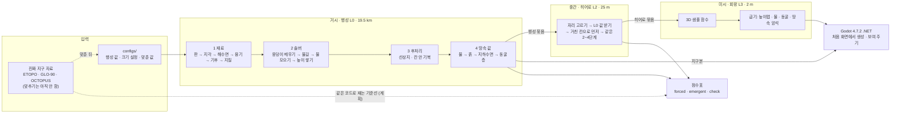

# B-PCG 한 장 요약

> 처음 합류한 팀원이나, 대화 창이 작은 AI 모델이 이 프로젝트를 한 번에 파악하려고 읽는 문서입니다(2026-10-27 기준). 무엇을 왜 만드는지, 어떻게 계산하는지, 코드가 어디 있는지, 지금 어디까지 됐는지를 한 장에 담았습니다. 자세한 내용은 맨 끝 '더 볼 곳'의 문서를 필요할 때만 엽니다. 처음 보는 말은 [용어집](glossary.md)에 있습니다.

## 직접 돌려 보기

[README](../README.md)의 '직접 돌려 보기' 1~4를 따릅니다. 가장 짧게는 이 두 줄입니다.

```bash
uv run bpcg all --profile tiny   # 작은 행성 하나를 끝까지 (약 3초, 마지막 줄 '[전체] 끝: 1.5 s → …')
uv run bpcg studio               # 결과를 지도로 보기 (http://127.0.0.1:8765)
```

---

## 1. 왜 만드나

게임 속 지형은 보통 노이즈(무작위 값을 매끈하게 겹쳐 만든 높이 무늬)로 만듭니다. 크기가 다른 노이즈를 여러 겹 겹칩니다. 빠르고 그럴듯하지만 두 가지가 안 됩니다.

- **물이 말이 안 됩니다.** 강이 웅덩이에서 끊기거나 산을 거슬러 오릅니다.
- **땅을 읽을 수 없습니다.** 절벽이 왜 거기 있는지, 동굴이 왜 그 높이에 있는지 설명할 원인이 없습니다.

B-PCG는 지각판의 움직임부터 계산해 땅을 만듭니다. 판이 부딪힌 곳에서 땅이 솟고, 그 땅에 내린 비가 강이 되어 산을 깎습니다. 그 산을 이룬 암석과 물이 그대로 땅속의 지층, 지하수, 동굴이 됩니다. 그래서 눈에 보이는 지형(절벽, 강, 동굴 입구)을 보고 그 원인(암석의 종류, 땅이 솟는 속도, 지하수의 높이)을 알아낼 수 있습니다. 이런 땅을 '읽히는 땅'이라고 부르고, 이 프로젝트가 지키려는 가치로 둡니다.

- **누가.** 중앙대 캡스톤디자인(1), 2026년 가을, 3인 팀. GitHub에 공개합니다([CAU-8/B-PCG](https://github.com/CAU-8/B-PCG)).
- **어떻게 확인하나.** 점수표(만든 행성이 물리 규칙을 지켰는지, 지구와 얼마나 비슷한지를 항목마다 숫자로 재는 표)로 우리 행성을 잽니다. 지금은 지구 값을 논문에서 가져와 견줍니다. 같은 점수표를 진짜 지구 자료에 돌리는 코드는 아직 없습니다(8장).
- **무엇이 새로운가.** 부품(다 자란 지형을 바로 푸는 계산, 동굴 높이 규칙 등)마다 선행 연구가 있습니다. 우리가 내세우는 점은 두 가지입니다.
    - 판의 움직임이 융기를, 융기가 산과 강을, 강 수면이 지하수와 동굴을 차례로 정하도록 부품을 한 줄로 잇습니다.
    - 그렇게 만든 행성과 진짜 지구 자료를 같은 점수표 코드로 재서 비교합니다(계획).

## 2. 무엇을 만드나

같은 땅을 세 가지 배율로 만듭니다. 기능은 사슬(앞 계산의 결과가 다음 계산의 입력이 되도록 이은 기능 줄) 세 개로만 설명합니다.

- 행성 지도(L0)는 행성 전체를 바둑판 칸으로 나눈 지도입니다.
- 히어로 유역(L2)은 행성에서 고른 유역(빗물이 모여 한 출구로 흘러 나가는 땅) 하나를 25 m 칸으로 다시 계산한 땅입니다.
- 회랑(L3)은 히어로 유역 안에서 플레이어가 걸어 다니도록 3D 지형 파일로 만든 띠입니다. 이 파일은 Godot(3D 세계를 보여 주는 오픈소스 게임 엔진)가 읽습니다.

| 배율 | 이름 | 크기 | 하는 일 |
|---|---|---|---|
| 거시 | 행성 지도 (L0) | 지구 전체. 칸 한 변 약 19.5 km(서울 남북 길이의 3분의 2), 칸 157만 개 | 판, 지각, 융기(땅이 솟아오르는 움직임), 기후를 정하고 큰 강과 산맥을 계산합니다 |
| 중간 | 히어로 유역 (L2) | 한 변 32 km(서울만 한 네모), 칸 25 m | 같은 계산을 촘촘한 칸으로 다시 해서 골짜기, 드러난 지층, 지하수, 동굴의 높이를 정합니다 |
| 미시 | 회랑 (L3) | 6 km × 1 km 띠(여의도의 약 2배), 2 m 간격 | 걸어 다닐 3D 지형과 땅속을 미리 계산해 Godot 파일로 만듭니다. 이 일을 '굽기'라고 부릅니다 |

| 사슬 | 행성 지도 L0 | 히어로 유역 L2 | 회랑 L3 |
|---|---|---|---|
| 1 뼈대: 판 → 지각 → 바다 바닥·융기 | 판, 지각 두께, 바다 바닥의 나이와 깊이, 해수면(정해 둔 바닷물 부피를 낮은 곳부터 채워 정함), 융기 | 융기와 출구 높이를 L0에서 받음 | (없음) |
| 2 조각: 암석 + 비 → 절벽·골짜기 | 큰 강과 골짜기 바닥, 지질 기둥(칸마다 지층이 쌓인 순서와 깊이) | 같은 규칙으로 다시 계산한 산비탈, 선상지(산 앞에 강이 흙을 부채꼴로 쌓은 땅), 드러난 지층, 흙 | 단면에 보이는 지층 절벽, 흙과 맨 암반(흙이 없어 암석이 드러난 땅) |
| 3 내부: 수면 → 지하수 → 동굴 | 큰 강·호수의 수면 | 지하수면(땅을 파 내려가다가 물로 꽉 찬 층을 처음 만나는 높이), 동굴 층의 높이와 입구 | 동굴 통로, 물에 잠긴 아래층 |

앞 사슬의 결과가 다음 사슬의 원인입니다. 예를 들어 사슬 1이 정한 융기가 사슬 2에서 산의 높이가 되고, 사슬 2가 정한 강 수면이 사슬 3에서 지하수면의 기준이 됩니다.



## 3. 어떻게 계산하나

### 3.1 네 단계

행성 하나는 이 순서로 만듭니다. 새 지구과학 기능은 이 네 칸 가운데 하나에만 들어갑니다.

1. **재료.** 판, 지각, 해수면, 융기, 기후, 지질을 식 하나씩으로 바로 계산합니다(반복 없음).
2. **솔버.** 솔버(산과 강이 다 자란 모양을 반복 계산으로 한 번에 구하는 프로그램)가 산과 강의 모양을 정합니다(3.2).
3. **후처리.** 솔버 규칙으로 만들지 않은 모양 두 가지를 덧붙입니다.
    - 선상지를 덧붙이고, 그 칸에는 솔버가 만든 모양이 아니라는 표시(`not_steady`)를 남깁니다.
    - 칸 안 기복(행성 지도의 19.5 km 칸 하나 안에 숨은 능선이 골짜기 바닥보다 얼마나 높은지 공식으로 어림한 값)을 더합니다. 행성 지도에서만 씁니다. 히어로 유역은 25 m 칸으로 능선을 직접 계산하기 때문입니다.
4. **땅속 값.** 물(호수·강), 흙, 지하수면, 동굴 층을 정합니다(3.3).

### 3.2 정상상태 솔버

진짜 산은 수백만 년에서 수천만 년에 걸쳐 자랍니다. 이 과정을 1년씩 계산하면 행성 하나에 몇 시간이 걸립니다. 그런데 오래 자란 산은 어느 때부터 모양이 거의 바뀌지 않습니다. 땅이 솟는 만큼 강이 깎아 내기 때문입니다.

그럼 처음부터 그 '다 자란 모양'만 바로 구할 수는 없을까요? 있습니다. 바다에서 출발해 상류로 한 칸씩 올라가며, 솟는 속도와 깎이는 속도가 같아지는 경사로 높이를 쌓습니다. 이렇게 더 바뀌지 않는 상태를 정상상태라고 부릅니다. 예를 들어 땅이 1년에 1 mm 솟는 곳이면, 그 칸의 강은 1년에 정확히 1 mm를 깎는 경사가 됩니다.

- **강 경사 규칙.** 강은 상류에서 가파르고 바다로 갈수록 완만해집니다. 물이 많이 모일수록 경사가 작아도 같은 양을 깎기 때문입니다. 식으로는 강 경사 = k_s · Q^(−θ)입니다.
    - Q는 그 칸을 1년에 지나는 물의 부피(m³/yr)입니다.
    - θ(오목도)는 물이 늘 때 경사가 줄어드는 정도로, 0.45로 둡니다.
    - k_s(강 가파름)는 같은 물의 양에서 강이 얼마나 가파른지 나타내는 값입니다.
    - 물의 양이 10배 늘면 경사는 10^(−0.45) ≈ 0.35배, 약 3분의 1이 됩니다.
- **산비탈.** 강이 없는 비탈은 사면 확산(흙이 비탈을 따라 천천히 흘러내리는 움직임) 규칙으로 경사를 정합니다. 강 경사와 비탈 경사를 섞은 뒤, 임계 경사(S_crit: 비탈이 무너지지 않고 버티는 가장 가파른 경사)를 넘지 않게 자릅니다. 임계 경사는 암석마다 0.4(충적층, 약 22°)~0.85(규암, 약 40°)이고, 암석 정보가 없을 때 쓰는 기본값 0.6은 약 31°입니다.
- **지층을 넘으면 경사가 바뀝니다.** 높이를 쌓다가 단단한 층에 들어가면, 그 층의 경사로 바꿔 이어 쌓습니다. 그래서 단단한 층에 절벽이 생깁니다.
- **반복은 하나뿐.** 높이를 쌓으면 물이 흐르는 방향이 바뀌고, 방향이 바뀌면 높이도 다시 쌓아야 합니다. 그래서 물길 방향이 바뀐 칸이 0개이고 모든 칸의 높이 변화가 0.1 m 미만일 때까지 되풀이합니다. laptop 프로필(행성의 크기와 해상도를 노트북에서 1분 안팎에 돌도록 묶어 둔 설정)과 시드(같은 행성을 다시 만들 때 쓰는 출발 번호) 0에서, 행성 지도는 50번, 히어로 유역은 175번 돕니다.
- **뒤집히는 칸 묶기.** 두 이웃의 경사가 거의 같은 칸은 반복마다 방향이 이쪽저쪽 뒤집힙니다. 그래서 새 방향이 2% 넘게 더 가파를 때만 방향을 바꿉니다(히스테리시스: 바뀐 직후 되돌아가지 않게 두는 문턱, 설정 `landscape.hysteresis_eta`). 방향이 16번 뒤집힌 칸은 그 뒤로 옛 방향을 지킵니다. 옛 방향의 이웃이 더 낮지 않아 물이 거꾸로 흐르게 될 때만 바꿉니다. 이런 칸을 고정 칸이라고 부릅니다. 16은 `Solver.FreezeAfterFlips`의 기본값이고, 설정 `landscape.freeze_after_flips`로 바꿀 수 있습니다.

### 3.3 땅속은 반복 밖에서 한 번

흙, 지하수, 동굴은 땅 위 모양을 읽기만 하고 바꾸지 않습니다. 그래서 솔버가 끝난 뒤 4단계에서 한 번 만듭니다. 원인은 늘 '땅 위 → 땅속' 한쪽으로만 갑니다.

- **흙.** 흙이 생기는 최대 속도(기온과 강수로 정함)가 땅이 솟는 속도보다 빠를 때만 흙이 쌓입니다(Heimsath 외 1997). 경사가 0.8(약 38.7°)보다 큰 칸도 흙을 0으로 둡니다.
- **두 겹 지하수면.** 지구에서는 셰일처럼 물이 거의 통하지 않는 층이 땅속에 끼어 있으면, 빗물이 그 위에 고여 따로 지하수면을 만듭니다. 그 아래 석회암은 물에 녹아 생긴 통로로 물이 가까운 강까지 빠집니다. 그래서 우리 코드(`Groundwater.WaterTable`)도 칸마다 높이 두 개를 둡니다.
    - 아래 지하수면은 가장 가까운 바다·호수·강 칸의 수면 + 0.002 × 그 칸까지의 거리(m)입니다. 0.002는 1 km 멀어질 때 2 m 오르는 기울기(m/m, 설정 `groundwater.karst_gradient`)입니다. 예를 들어 수면이 140 m인 강에서 1 km 떨어진 칸이면 142 m입니다.
    - 아래 지하수면은 그 높이가 땅 겉보다 낮고, 그 높이의 암석이 석회암이나 대리암일 때만 씁니다. 아니면 아래 지하수면은 위 지하수면과 같습니다.
    - 위 지하수면은 빗물이 고르게 스며 물가로 빠질 때 솟는 물 언덕의 높이(Dupuit 어림식)로 정합니다.
    - 투수율(암석이 물을 통과시키는 정도) log10 k(k의 단위는 m²)가 −15 이하인 층은 물을 막는 층으로 봅니다. 지금 암석 표에서는 셰일(−16.5)뿐입니다.
- **동굴 층의 높이.** 지구에서 동굴은 물에 녹는 암석 안에서 지하수면 높이를 따라 수평으로 자랍니다. 강이 골짜기를 더 파 내려가면 지하수면도 내려가고, 옛 높이에 생긴 동굴은 말라서 위에 남습니다(Audra & Palmer 2011).
    - 동굴 층은 0층과 1층 둘입니다(설정 `caves.levels` = 2).
    - 우리 코드에서 0층 동굴은 아래 지하수면 높이에 둡니다.
    - 1층 동굴은 가장 가까운 물의 수면 + 0.35 × 골짜기 깊이에 둡니다. 골짜기 깊이는 강 둘레 1.5 km 안에서 가장 높은 땅과 강 수면의 높이 차입니다.
    - 0.35(설정 `caves.incision_fraction`)는 우리가 정한 값입니다. 예를 들어 골짜기 깊이가 400 m이면 1층 동굴은 강 수면보다 140 m 높습니다.
    - 어느 층이든 조건을 모두 맞출 때만 동굴을 둡니다. 그 높이의 암석이 물에 녹는 암석(석회암·대리암)이고, 땅 겉 아래 300 m(설정 `groundwater.max_depth_m`) 안이고, 땅 겉보다 6 m 넘게 낮거나 입구 칸이어야 합니다. 1층은 0층보다 3 m(통로 반지름) 넘게 높아야 합니다.

### 3.4 같은 코드로 공과 평면

칸마다 위치, 이웃 8개, 이웃까지 거리, 넓이를 담은 표(`CellGraph`) 하나로 공 모양 행성과 평면 유역을 같은 코드로 계산합니다. 공은 큐브스피어(정육면체 여섯 면을 바둑판으로 나눈 뒤 부풀려 만든 공 모양 격자)입니다. 칸 번호는 `c = 면 번호·n² + 줄 번호·n + 열 번호`입니다. n은 한 면의 한 변에 놓인 칸 수이고, laptop 프로필의 행성 지도에서 512입니다. 예를 들어 1번 면의 0줄 0열 칸은 512² = 262,144번입니다.

## 4. 크기와 시간 (laptop 프로필, 시드 0)

| 배율 | 칸 | 하는 일 | 걸린 시간 |
|---|---|---|---|
| 거친 격자 | 면당 128 × 128, 칸 약 78 km(제주도 동서 길이보다 조금 김) | 판, 지각, 해수면, 융기, 기후를 먼저 만들어 L0로 옮김. 해수면과 기후는 L0에서 다시 계산 | 0.3 s (L0 시간에 포함) |
| 행성 지도 L0 | 면당 512 × 512, 모두 157만 칸, 칸 약 19.5 km | 1~4단계 전부 | 15.8 s (지각 세기 첫 풀이 8.5 s, 솔버 2.1 s) |
| 히어로 유역 L2 | 1280 × 1280, 164만 칸, 칸 25 m, 한 변 32 km | 2~4단계를 같은 코드로 | 32.7 s (솔버 16.4 s) |
| 회랑 L3 | 6 km × 1 km, 높이맵 2 m(501 × 3001), 땅속 암석 4 × 4 × 2 m | 3D 샘플 함수(아무 3D 점을 물으면 그 자리의 암석, 물, 동굴을 답하는 함수)에 물어 엔진 파일로 굽기 | 17.4 s (동굴 메시 8.1 s) |
| 지구본 | 면당 256 × 256 | L0 값을 엔진 지구본용으로 다시 담기 | 1.2 s |

- 지각 세기 첫 풀이는, 칸마다 평균 높이가 지각이 버틸 수 있는 높이(5,500 m, 백두산의 약 2배)에 얼마나 가까운지 보려고 솔버를 먼저 한 번 돌리는 계산입니다. 평균 높이가 한계에 가까울수록 융기를 더 많이 줄인 뒤 다시 풉니다. 예를 들어 평균 높이가 2,750 m인 칸은 융기를 약 6% 줄이고, 5,500 m 이상인 칸은 바탕 융기(100만 년에 5 m)만 남깁니다.
- 전체 `uv run bpcg all --profile laptop`(시드 0): 71.7 s와 91.3 s, 최대 메모리 사용량 약 3.4 GB(`/usr/bin/time -l`의 peak memory footprint). 맥북 에어 M3(8코어, 16 GB)에서 2026-10-27에 두 번 잰 값입니다. 두 번 모두 다른 프로그램이 함께 돌았고(부하 평균 3~10), 부하가 높을수록 느렸습니다. 위 표의 단계별 시간은 71.7 s 실행의 값입니다.
- 설계도는 L3를 1 m 상자(복셀: 3D 공간을 나눈 작은 상자 칸)라고 적었습니다. 지금 굽기는 2 m 높이맵과 4 × 4 × 2 m 땅속 암석 상자입니다.
- 행성 반지름은 지구와 같은 6,371 km입니다(서울–부산 직선거리의 약 20배). 진짜 지구 자료와 같은 크기에서 비교하고, 판과 대기에 지구의 값을 그대로 쓰려고 지구 크기로 둡니다.

## 5. 코드 지도

생성기는 C#(`src/Bpcg/`)입니다. 폴더 사이 참조는 한 방향입니다(거꾸로 금지).

```text
Core, IO, Numerics → Planet, Geology, Hydro → Landscape → Subsurface → Hero, Volume → Bake → Runs, Compare
```

계산 함수는 파일을 읽거나 쓰지 않습니다. 파일 쓰기는 `Bake/`·`Runs.cs`에서만 합니다.

| 위치 | 하는 일 | 입구 |
|---|---|---|
| `src/Bpcg.Cli/` | 명령줄 `bpcg planet / hero / bake / all / compare` | `Program.Main` |
| `Runs.cs`, `Pipeline.cs` | 실행 순서(명령줄과 엔진이 같이 씀), 행성·유역 만들기, 2~4단계 공통 | `Runs.All`, `Pipeline.GeneratePlanet`, `GenerateHero` |
| `Core/` | 큐브스피어, `CellGraph`, 정수 해시(SplitMix64), 노이즈, 설정 읽기(`Config.LoadConfig`, `--set` 검사), 필드 목록, 경로 | |
| `IO/`, `Numerics/` | npy·npz·JSON·TOML 파일, scipy 대신 직접 짠 수치 함수(KD-tree, 필터, FFT, numpy와 같은 덧셈 순서) | |
| `Planet/` | 사슬 1과 기후: 판, 지각, 해수면, 융기, 기후, 재료 | |
| `Geology/` | 암석 표, 지질 기둥(쌓인 순서 3종, 변성) | `GenerateGeology`, `BuildColumns` |
| `Hydro/` | 웅덩이 메우기, 물길 방향(D8: 둘레 여덟 칸 가운데 가장 가파르게 내려가는 칸으로 물을 보냄), 하류부터 순서, 물 모으기, 유역·강 구간 | `Routing.D8Receivers`, `AccumulateModule.Accumulate` |
| `Landscape/` | 정상상태 솔버, 선상지, 칸 안 기복, 거친 칸으로 먼저 풀기 | `Solver.SolveSteadyState` |
| `Subsurface/` | 사슬 3: 물(호수·강), 흙, 지하수면, 동굴 층 | |
| `Hero/` | 유역 자리 고르기, 크기, L0 값 받기, 평면 히어로(행성 없이 정해 둔 융기와 출구로 바로 만드는 히어로 유역) | `Finder.FindHero`, `Refine.RefineHero`, `Flat.FlatHero` |
| `Volume/` | 아무 3D 점에 "무엇이 있나"(암석, 물, 지표까지 거리, 동굴까지 거리)를 답하는 함수 | `HeroVolume` |
| `Bake/` | 묶음(단계 사이에 넘기는 결과 폴더, 아래 설명) 읽기·쓰기, 회랑 굽기, 동굴 메시, 프랙탈 디테일(25 m 지도가 그리지 못하는 50 m보다 짧은 거칠기를 회랑 땅 겉에 더한 보기용 높이. 솔버 결과가 아님), 지구본 | `BakeCorridor`, `BakeGlobe` |
| `Metrics/` | 점수표, 물길·높이 분포 지표 | `Scorecard.Build` |
| `Compare/` | 기존 지형 생성 방법과 같은 시드로 견주기 | `uv run bpcg compare run` |
| `src/bpcg_studio/` (파이썬) | 스튜디오(매개변수를 바꿔 행성을 다시 만들고 결과를 지도로 보는 브라우저 도구). C# 명령줄을 빌드해 돌리고 결과 파일을 읽음. `bpcg` 명령의 입구 | `uv run bpcg studio` |

- **묶음.** 단계 사이에는 결과 폴더 하나를 넘깁니다. 이 폴더를 묶음이라고 부릅니다. 목차(`manifest.json`: 설정 전체, 시드, 커밋, 시간), 칸 정보(`graph.npz`), 지도마다 파일 하나(`<그룹>/<필드>.npy`)가 들어 있습니다.
- **같은 시드면 같은 행성.** 지형에 들어가는 무작위 값은 정수 해시로만 만듭니다. 병렬 계산은 칸마다 자기 자리에만 씁니다. 그래서 코어 수가 달라도 결과가 비트까지 같습니다.
- **정밀도.** 솔버의 높이와 웅덩이 메우기는 double(소수 약 16자리), 엔진 파일은 float32(약 7자리)입니다.
- **시험.** C#은 `dotnet test --solution Bpcg.slnx`(`tests/Bpcg.Tests/`), 파이썬은 `uv run pytest -m "not slow"`(`tests/test_*.py`, C# 결과 파일·스튜디오·엔진 검사)입니다. C# 시험 가운데 golden 대조 시험은 golden 파일(옛 Python 생성기의 결과를 정답으로 저장해 둔 시험 자료)과 비트까지 같은지 봅니다. 큰 golden 사례를 쓰는 시험 26개는 파일이 없어 건너뜁니다([history.md](history.md) 2026-10-03 줄).

## 6. 엔진 (`engine/`, Godot 4.7.2 .NET)

- 엔진의 C# 코드(`engine/Scripts/*.cs`)가 생성기(`src/Bpcg`)를 그대로 씁니다. 처음 화면(`start.tscn`)에서 행성을 만들 수 있고, 구운 파일을 3D로 보여 줍니다. C#을 지원하지 않는 Godot 기본 버전으로는 열리지 않습니다.
- 좌표는 X = 동, Y = 위, Z = 남입니다.
- 장면은 처음 화면, 회랑(`main.tscn`), 지구본(`globe.tscn`) 셋입니다. M 키로 회랑 ↔ 지구본, N 키로 처음 화면.
- 레이어(숫자 키로 켜고 끔): 1 회랑 지형, 2 주변 25 m 지형, 3 수면, 4 지하수면, 5 동굴, 6 지층 단면, 7 동굴 입구 구멍, 8 프랙탈 디테일.
- 주요 키: V 날기 ↔ 걷기, X 단면 칼(눈앞에 세로 면을 세워 그 앞의 땅을 지우고 땅속을 보여 줌), T 동굴 입구로 옮겨 가기, G 지질도, F 손전등, `-`/`=` 글자·패널 크기.
- 실행 중에 땅을 파는 기능(godot_voxel 확장으로 복셀을 바꾸는 기능)은 넣지 않았습니다. 땅속은 미리 구운 회랑과 단면 칼로 보여 줍니다.

## 7. 자료와 학습

**받는 자료.** `tools/download_pilot.py`가 모두 약 4.5 GB를 받습니다. 파일마다 크기와 해시는 `data/manifest.json`에 있습니다.

| 이름 | 무엇인가 | 쓰는 곳 |
|---|---|---|
| ETOPO 2022 | (자료, 여러 자료를 이은 합성) 미국 NOAA NCEI의 지구 전체 높이 지도. 육지와 바다 밑을 한 파일에 담았고, 적도에서 칸 약 1.85 km | 고도 분포 그림과 지구 바다 비율 |
| Copernicus GLO-90 | (자료, 관측) 위성 레이더로 잰 90 m 간격 육지 높이 지도. 나무와 건물 꼭대기 높이가 섞임. 시험 유역 40개를 덮는 타일 55개 | θ·k_s 맞추기 (계획) |
| RiverATLAS | (자료, 계산과 모델) 하천 구간 약 850만 개와, 구간마다 붙인 유량·경사 같은 속성 | θ·k_s 맞추기 (계획) |
| OCTOPUS | (자료, 관측) 강 모래 속 베릴륨-10의 양으로 잰 유역 평균 침식률(mm/kyr). 유역 5,673개 | k_s 맞추기 (계획) |
| CHELSA bio12 | (자료, 모델) 1981~2010년 평균 연강수. 약 1 km 간격 | 유역의 물의 양 (계획) |
| Global Aridity v3.1 | (자료, 모델) 연강수를 잠재 증발량으로 나눈 건조 지수. 약 1 km 간격 | 마른 유역과 젖은 유역 나누기 (계획) |

자료마다 크기, 출처, 라이선스, 받는 법은 [data/README.md](../data/README.md)에 있습니다. 비교하면 좋은 점과 생기는 문제는 ETOPO와 fastscapelib에 대해 [Humanize.md](../Humanize.md) 규칙 7의 예시에 적혀 있습니다.

**'학습'의 뜻.** 딥러닝이 아닙니다. 진짜 지구 자료로 생성기 규칙 속의 숫자를 맞추는 일입니다.

- θ(오목도): χQ 분석으로 잽니다. 강을 출구에서 상류로 따라가며 (기준 물의 양 ÷ 그 칸의 물의 양)^θ에 칸 사이 거리를 곱해 더한 값을 χQ라고 부릅니다. 유역 안에서 융기 속도와 암석이 고르고 강이 정상상태이면, θ가 맞을 때 강 높이를 χQ에 대해 그린 그래프가 직선이 됩니다. 그래서 그래프를 가장 곧게 만드는 θ를 고릅니다.
- k_s(강 가파름): OCTOPUS 침식률과 강 가파름의 관계로 잽니다.
- S_crit(임계 경사): 침식률이 약 0.3 mm/yr(100만 년에 300 m) 이상인 산지(예: 대만, 히말라야)에서는 비탈이 더 가팔라지지 않습니다. 그런 산지에서 잰 비탈 경사를 S_crit로 씁니다.
- 마지막으로 솔버를 돌려, 결과가 자료와 맞도록 숫자를 거꾸로 맞춥니다.
- 맞춘 값은 `configs/learned/`에 넣고, 코드는 바꾸지 않습니다.

**지금은 맞추기 전입니다.** θ = 0.45 같은 값은 논문에서 가져온 값이거나, 첫 실행 뒤 손으로 고친 값입니다.

**30 m 높이 지도로 θ를 재면 생기는 문제.** 미국 NASA가 비행기 레이더로 가봉 숲을 찍은 자료(AfriSAR)의 높이로 θ를 재 보니 0.07~0.13이 나왔습니다. 지구 강의 보통 범위 0.3~0.7보다 훨씬 작습니다. 레이더는 숲 지붕을 땅으로 잡지만, 땅 높이를 보정해도 θ는 0.07~0.08 그대로였습니다. 그래서 30 m 칸마다 잰 경사가 높이의 작은 흔들림(1~2 m)에 크게 흔들린 탓으로 봅니다([design/blueprint.md](design/blueprint.md) 부록 A-2).

## 8. 무엇이 새롭고 어떻게 확인하나

| 기존의 빈틈 | B-PCG | 합격선 | 2026-10-27 상태 |
|---|---|---|---|
| 다 자란 지형을 바로 푸는 방법은 모두 평면에만 있고, 공 위의 침식 계산은 모두 시간을 한 걸음씩 돌림 | 공 모양 행성 전체에서 다 자란 지형을 바로 풂 | 강 100%가 바다·호수에 닿음. 거꾸로 흐르는 강 0. 격자 정렬 지수(강이 바둑판의 가로·세로·대각 방향을 얼마나 따르는지. 방향이 무작위일 때 1이고, 클수록 바둑판 방향을 많이 따름)가 면 경계와 안쪽에서 같고 1.3 미만. 행성을 돌려 다시 만들어도 통계가 같음. 같은 입력에서 fastscapelib(땅이 솟고 강이 깎는 과정을 시간 순서로 계산하는 프로그램)과 고도 분포 차이 5% 미만 | 강 100%, 역류 0, 정렬 지수 면 경계 0.91·안쪽 0.90. 회전 시험과 fastscapelib 비교는 없음 |
| 3D 지층·동굴 연구는 지하수면을 사람이 넣고, 게임의 동굴은 노이즈 | 지질 모델 하나가 산의 모양과 화면의 암석을 함께 정하고, 지하수와 동굴을 물길에서 계산 | 경사를 만든 암석과 보이는 암석이 100% 같음. 동굴이 있는 칸은 100% 물에 녹는 암석. 물 규칙(지하수면이 땅 위로 솟지 않음 등) 위반 0 | 셋 다 맞음. 골짜기 벽 단면 1,000개로 지층 순서를 보는 시험은 없음 |
| 진짜 지구 자료를 생성기와 같은 코드로 잰 값이 없음 | 기준선(진짜 지구 높이 지도 ETOPO를 우리 행성과 같은 칸에 옮겨 담고, 같은 점수표 코드로 잰 값)을 둠. 노이즈만으로 만든 행성, 기능 하나(예: 지층마다 경사 바꾸기)를 끄고 만든 행성과도 비교 | emergent 지표만 근거로 씀 | 기준선과 비교 행성을 만드는 코드가 없음 |
| 유역마다 다른 θ·k_s를 생성기 입력으로 쓴 사례가 없음 | GLO-90과 OCTOPUS로 재서 입력 지도로 씀 | 맞춘 식의 설명력(R²: 1이면 자료를 완전히 설명)을 보고함. 진짜 지구 높이 지도로 다시 계산한 상류 면적(한 칸까지 빗물이 모여 오는 위쪽 땅의 넓이)의 오차가 10% 이하 | 맞추는 스크립트가 없음 |
| 걸어 다니는 크기의 땅은 노이즈로 채움 | 히어로 유역을 같은 규칙으로 25 m에서 다시 풂 | 강 가파름이 같은 등급인 진짜 30 m 지형(설계도는 SRTM)과 경사·고도 분포 차이(KS: 두 누적 분포 곡선이 가장 크게 벌어진 간격, 0~1)가 0.15 미만 | 다시 풀기는 됨. KS 시험은 없음 |

**지표 세 종류.**

- **forced:** 입력으로 정한 값이 거의 그대로 나오는 지표입니다. 예: 고도 분포의 두 봉우리(넓이가 몰린 높이 두 곳). 맞아도 지구와 닮았다는 근거가 아니라, 코드가 망가지지 않았는지 보는 데만 씁니다.
- **emergent:** 입력에 없던 성질이 결과로 나온 지표입니다. 예: Hack 지수. 지구와 닮았다는 근거로 쓰는 지표는 이 종류뿐입니다.
- **check:** 꼭 지켜야 하는 규칙입니다. 예: 거꾸로 흐르는 강 0. 어기면 불합격입니다.

**가장 가까운 작업.**

- **Wildforge(2026):** 큐브스피어 행성 전체의 물길에서 강·호수·바다, 지하수와 샘, 판에서 나온 지층, 동굴까지 만드는 복셀 게임입니다. 동굴은 노이즈이고, 지하수로 동굴 위치를 정하는 기능은 계획 단계입니다.
- **triangulum(2026):** 파이썬으로 구 격자에서 물길·하천 침식·융기·호수를 계산해 굽고, 복셀 뷰어로 보여 줍니다. 구조가 우리와 거의 같지만 지층과 지하수면 계산은 찾지 못했습니다.
- **PlanetCreator:** 시간을 한 걸음씩 돌려 침식을 계산하고, 지구 통계에 맞춰 보정합니다. 복셀은 없습니다.
- **World Orogen(2026), goSPL(2020), fastscapelib:** 구 위에서 시간을 한 걸음씩 돌려 침식을 계산합니다.
- **Cortial 2019:** 노이즈로 경계를 휜 판으로 행성을 만드는 그래픽스 연구입니다. 우리 판 계산은 이 방법을 줄여서 씁니다.
- **솔버:** 우리 솔버는 Steer 2021, Tzathas 외 2024, MuddPILE과 사실상 같은 방법입니다. 이 셋은 모두 평면에서만 풉니다.

<details><summary>확인한 인용</summary>

- Cortial 2019: 24명에게 그림 6쌍을 보여 준 144표 가운데 판 행성 97표, 노이즈 47표. 사실감만 물었고 행성 전체 그림입니다. 논문에 적힌 χ² 8.3은 다시 계산한 값 17.4와 다릅니다.
- Galin 2019: *Computer Graphics Forum* 38(2):553–577, doi 10.1111/cgf.13657.
- Zechmann & Hlavacs 2025: GAME-ON 2025 pp.15–19, arXiv 2510.24764, 참가자 15명. "비교 대상도 전부 노이즈"는 우리 해석입니다.

</details>

## 9. 2026-10-27 기준으로 되는 기능과 안 되는 기능

**되는 기능.**

- 행성 → 히어로 유역 → 회랑 → 지구본이 끝까지 돕니다.
- Godot 처음 화면·회랑·지구본, 스튜디오가 됩니다.
- `--set`(설정 파일을 고치지 않고 값 하나만 바꿔 돌리는 옵션)으로 값을 바꿀 수 있습니다.
- 기존 지형 생성 방법과 같은 시드로 비교할 수 있습니다(`bpcg compare`).

**점수표 (laptop 프로필, 시드 0, 2026-10-27 실행).**

- **check:** 행성 지도 11개, 히어로 유역 10개 항목이 모두 통과했습니다. 합격선이 있는 forced 지표인 고도 분포의 두 봉우리(1,000 m 넘게 떨어졌는지 봄)도 합격했습니다.
    - 강이 바다·호수에 닿는 비율 100%, 거꾸로 흐르는 강 0
    - 칸마다 지나는 물과 흙·돌의 양이, 상류 칸에서 생긴 양을 모두 더한 값과 맞음. 합격 기준은 상대 오차 100만분의 1(1e-6) 이하
    - 암석 일치 100%, 동굴이 녹는 암석 안에 있는 비율 100%, 물 규칙 위반 0
    - 격자 정렬 지수 L0 0.91(면 경계)·0.90(안쪽), 히어로 유역 1.13
- **Hack 지수(emergent):** 큰 강일수록 본류가 길지만, 넓이가 늘어나는 비율만큼 길어지지는 않습니다. 본류 길이 L(km)이 유역 넓이 A(km²)의 몇 제곱에 비례하는지를 Hack 지수 h라고 부릅니다(L = c·A^h). L0는 0.587, 히어로 유역은 0.514로 지구 강의 범위 0.49~0.6 안입니다.
- **바다 비율:** 0.625로 지구 0.708보다 작습니다. 열 칸 가운데 여섯 칸이 바다입니다(지구는 일곱 칸). 점수표는 emergent로 세지만, 대륙 지각이 덮는 넓이의 입력값 0.40(설정 `plates.continental_area_fraction`)이 값을 거의 정합니다. 바다 지각 넓이 0.60에서 해수면 위로 솟은 바다 지각(섬, 약 0.01)을 빼고, 바다 밑에 잠긴 대륙 가장자리(약 0.035)를 더한 값입니다.
- **지하수면이 땅 겉에서 0.5 m 안인 땅(emergent):** 히어로 유역에서 1.7%입니다(강·호수 칸을 넣은 점수표 값이고, 마른 땅만 세면 1.1%입니다). 지구 평균은 16~22%입니다(Fan 외 2013). 가파른 산지라 지구 평균보다 낮은 방향은 맞지만, 얼마나 낮아야 맞는지는 아직 보이지 못했습니다.

**아직 해결하지 못한 문제.**

- 히어로 유역 칸의 30%(490,292칸)가 물길 방향이 계속 뒤집혀 고정 칸이 되었습니다.
- 동굴 메시가 큽니다. `caves.glb`가 288 MB, 삼각형 1,106만 개입니다. 메시를 조각으로 나누거나, 멀리 있는 부분을 단순하게 그리는 기능(LOD)이 없습니다.
- 대륙붕(수심 200 m보다 얕은 대륙 가장자리 바다)이 바다의 0.34%입니다(지구는 약 7~9% [확인 필요]). 강이 실어 온 흙을 바다 가장자리에 쌓는 계산이 없습니다.
- 평면 히어로(행성 없이 정해 둔 융기와 출구로 바로 만드는 히어로 유역)에는 선상지가 생기지 않습니다.
    - 선상지 꼭짓점은 하류로 가며 강 경사가 4배 이상 줄어드는 곳으로 고릅니다(설정 `fans.slope_drop_ratio`).
    - 이 문턱 4는 깎는 속도가 경사에 비례할 때(경사 지수 n = 1)에 맞춘 값입니다.
    - 지금은 n = 2(설정 `landscape.slope_exponent_n`)라서, 융기가 4배 줄어도 강 가파름은 2배만 줄어듭니다. 그래서 경사가 4배 넘게 줄어드는 곳이 드뭅니다.
- 경사가 0.8보다 큰 칸의 흙을 0으로 두는 규칙이 거의 걸리지 않습니다. 히어로 유역 164만 칸 가운데 36칸입니다. 솔버가 경사를 암석마다 임계 경사 이하로 자르는데, 임계 경사가 0.8보다 큰 암석은 규암(0.85)뿐이기 때문입니다. 히어로 유역의 37%는 맨 암반이지만, 모두 흙이 생기는 속도가 땅이 솟는 속도보다 느려서 생긴 맨 암반입니다.
- 지하수면은 가장 가까운 물 하나를 기준으로 정해서, 두 강 사이 능선 밑에서 계단처럼 끊길 수 있습니다. 골짜기 바닥의 샘과 습지도 만들지 않습니다.
- 동굴 통로의 평면 모양이 물길과 상관없는 노이즈입니다.
- 강이 시작되는 지점을 너무 하류로 잡습니다. 지금 식은 물길이 시작되는 데 필요한 상류 면적을 Kargère 2025 원문 식보다 3.83배 크게 잡습니다. 그래서 히어로 유역에 실개천이 너무 적게 생깁니다. 원문 식으로 바꿀 예정입니다([design/blueprint.md](design/blueprint.md) 5장 9번).
- 산과 판의 무게가 지각을 휘게 하는 효과와, 산이 비구름을 막아 한쪽에만 비가 많이 오는 효과가 없습니다.
- 차별점을 증명할 시험 대부분이 없습니다(8장 '2026-10-27 상태' 칸).

**다음에 넣을 기술**([future_tech.md](future_tech.md)):

- 자료로 θ·k_s·S_crit 맞추기
- 솔버 빠르게 하기: 멀티그리드(거친 격자와 촘촘한 격자를 오가며 반복마다 오차를 줄이는 방법. 지금 코드는 거친 칸의 답을 촘촘한 칸의 출발점으로 한 번만 넘깁니다), 앤더슨 가속(지난 몇 번의 반복 값을 섞어 다음 값을 고르는 방법)
- 칸끼리 물을 주고받는 2차원 지하수 방정식
- 동굴 위치 규칙
- 동굴 메시 나누기와 LOD

## 10. 일정과 역할

- **역할.**
    - A: 행성 바탕(격자, 판, 지질, 기후, 기준선, 점수표)
    - B: 물·지형·땅속(물길, 솔버, 히어로 유역, 흙, 지하수, 동굴)
    - C: 엔진·데모
- **남은 날짜.**
    - 11/4 히어로 v1과 지층 경계 계산 점검
    - 11/11 꼭 할 기능 동결(그날부터 새 기능을 넣지 않음)
    - 11/18 데모 동결
    - 12/4·12/11 최종 데모(성적 60%, 수강생 투표 포함)
    - 12/18 보고서·사용 설명서·공개
- **일이 시간보다 많습니다.** 사슬 셋과 기준선에 12.5~14인주가 들지만, 쓸 수 있는 시간은 6~8인주입니다. 인주는 한 사람이 한 주에 하는 일의 양(20시간)입니다. 모자라면 쓸 대체안이 정해져 있습니다.
    - 히어로 25 m 다시 풀기 → 칸 안 기복에 노이즈
    - 2층 동굴 → 노이즈 1층
    - 지하수 식 → 가까운 수면 높이로 어림
    - 지층마다 경사 바꾸기 → 색칠만
- **멘토 피드백에 대한 대응(제안, 설계도에 아직 안 넣음).** 세 가지가 필요합니다.
    - 왜 필요한지와 핵심 가치('읽히는 땅')
    - 몰입을 재는 지표: 두 그림 가운데 진짜 같은 쪽 고르기, '물이 어디로 흐를지·동굴이 어디 있을지' 맞히기
    - 기존 게임과 나란히 보이기: 노이즈 / B-PCG / 진짜 GLO-90 세 칸

## 11. 발표와 보고서에서 쓰지 않는 말

글과 작업 규칙은 [CLAUDE.md](../CLAUDE.md)와 [Humanize.md](../Humanize.md)에 있습니다. 발표와 보고서에서는 다음을 더 지킵니다.

- '최초', '새 솔버', '새 동굴 기법'이라고 말하지 않습니다.
- 지하수 식은 어림식이므로 '물리 모델'이라고 부르지 않습니다.
- forced 지표를 지구와 닮았다는 근거로 쓰지 않습니다.

## 12. 더 볼 곳

| 알고 싶은 내용 | 파일 |
|---|---|
| 말의 뜻 | [glossary.md](glossary.md) |
| 글 쓰는 법 | [Humanize.md](../Humanize.md), [writing.md](writing.md) |
| 확정 설계(사슬, 배율, 일정, 선행 연구) | [design/blueprint.md](design/blueprint.md) (필요한 장만) |
| 단계마다 공식과 함수의 약속, 아직 해결하지 못한 문제 | [pipeline.md](pipeline.md) (해결하지 못한 문제는 14장) |
| 지운 코드, 다시 올린 PR 같은 지난 사정 | [history.md](history.md) |
| C# 포팅 기록, 대조 결과, 남은 일 | [csharp_port.md](csharp_port.md) (0장부터) |
| 규칙 전체 | [conventions.md](conventions.md), [CONTRIBUTING.md](../CONTRIBUTING.md) |
| 단계별 할 일과 증거 | [roadmap.md](roadmap.md) |
| 다음에 넣을 기술 | [future_tech.md](future_tech.md) |
| 엔진 조작과 파일 형식 | [engine/README.md](../engine/README.md), [engine/GLOBE.md](../engine/GLOBE.md) |
| 스튜디오 | [studio.md](studio.md) |
| 기존 방법과 견주기 | [compare.md](compare.md) |
